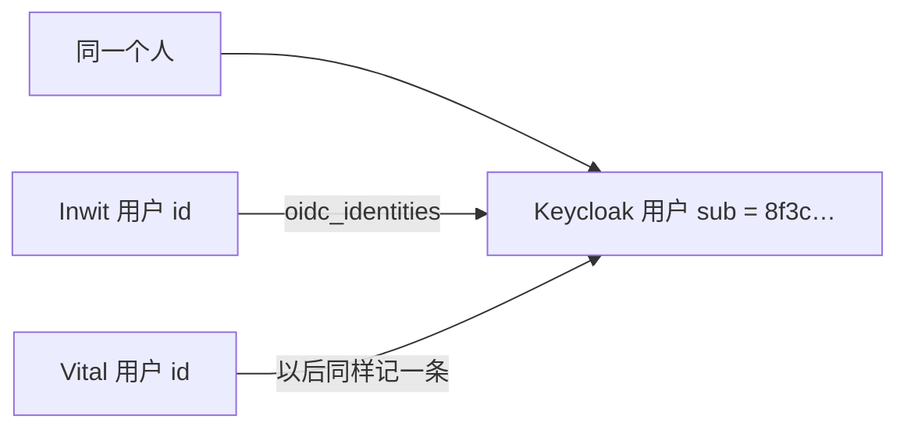

# 共用 Keycloak 的账号导入

| 项 | 值 |
| --- | --- |
| 日期 | 2026-11-19 |
| 状态 | `inwit_prod` 已导入 `aimo-plus-prod` |
| 相关 | `docs/design/oidc-login.md` |
| 范围 | 把已有应用账号一次性导入共用 Keycloak。不改登录页，不打开自助注册 |

## 概述

Inwit、Vital 以及其他应用共用一套 Keycloak 26.8.2。test 与 prod 仍是两个 realm，账号不互通。同一个 realm 里，一个人只有一条 Keycloak 用户。这条用户的 id 就是各应用 token 里的 `sub`。

各应用保留自己的用户表和业务数据。应用只多记一条对应关系：本应用用户 id ↔ `(issuer, sub)`。登录身份统一，文档、任务、令牌仍在各自的库里。

这次先导入 `inwit_prod` 到 realm `aimo-plus-prod`。Vital 以后按同一规则导入，不在这次执行。

## sub 是什么

`sub` 是 Keycloak 给这个人的编号，一个 UUID。它写在 access token 和 ID token 的 `sub` 字段里。它不是邮箱，也不等于 Inwit 或 Vital 自己的用户 id。

同一个人在 `aimo-plus-prod` 里永远是同一个 `sub`。他在 test realm `aimo-plus-test` 里是另一条用户、另一个 `sub`。换 realm 之后对不上。

应用之间靠这个编号认出同一个人：



Inwit 登录成功后仍签发自己的会话。Keycloak access token 只在登录时核对，不拿来调 Inwit 的业务 API。Vital 以后也一样：各自的 audience，各自的 API。

## 范围

这次做：

- 数据来源：Inwit 生产库 `inwit_prod` 的 `users`。连接信息在应用机 `/root/apps/inwit/.env`。
- 目标 realm：`aimo-plus-prod`。
- issuer：`https://super-agent-auth.aimo.plus/realms/aimo-plus-prod`。
- 通道：Keycloak Admin API。先向 master realm 用 `admin-cli` 和密码模式换管理员 token，再调用 `/admin/realms/aimo-plus-prod/users`。管理员口令只读应用机 `/root/apps/super-agent-oidc/.env`，不写入仓库、文档或日志。

这次不做：

- 不导入 `inwit_dev`、`inwit_test`，也不把生产用户复制进 `aimo-plus-test`。
- 不导入 Vital。规则写在下面，等 Vital 单独执行。
- 不连接 PostgreSQL 库 `aimo_oidc`。Keycloak 自己的库只给 Keycloak 用。
- 不打开 Keycloak 自助注册，不调用 `registration_endpoint`。
- 不给 Inwit 或 Vital 打开密码模式。用户以后在 Keycloak 登录页输入原来的密码。
- 不复用 client `super-agent-native`，不使用 audience `super-agent-api`。
- 不把对应关系或密码哈希提交进 git。

## 每个应用仍是独立 client

同一个 realm 里的应用共用用户目录，不共用 client。

| 应用 | clientId | access token audience | 状态 |
| --- | --- | --- | --- |
| Super Agent | `super-agent-native` | `super-agent-api` | 已有，不要改 |
| Inwit | `inwit` | `inwit-api` | 登录功能另按 `oidc-login.md` 开通 |
| Vital | `vital` | `vital-api` | 以后开通，本次不建 |

client 仍按 `oidc-login.md`：有服务端的用 confidential client，授权码加 PKCE S256，精确回调，默认 scope 含 `basic`、`profile`、`email`。audience mapper 只写进 access token。

这次导入只创建用户和密码凭证，不创建 client。

## 去重与密码

按邮箱去重，邮箱先 `trim` 再转小写。Inwit 注册和登录已经这样存。生产库里若仍有两条折成同一个邮箱，这两条都跳过，不猜测哪条密码该留下。

Keycloak 里这个邮箱还没有人：

- 新建用户。`username` 和 `email` 都是这个小写邮箱。`enabled = true`。`emailVerified = true`，避免 realm 若要求已验证邮箱时把老用户锁在外面。Inwit 本身没有做过邮箱验证，这里只是让导入后的登录页不再要求再验一次。
- `firstName` 和 `lastName` 都必须有值。realm 的用户资料把这两项设成了用户必填，缺了会在登录后停在「更新资料」，进不了应用。有空白可拆时，最后一段做 `lastName`，其余做 `firstName`。只有一个名字时，两栏都写这个名字。`display_name` 为空时，两栏都写邮箱 `@` 左边的一段；清掉姓名禁止字符后仍为空，就写「用户」。不改 realm 的必填规则，以免影响 Super Agent。
- 密码用下面的哈希转换写入，`temporary = false`。不提交明文，因为库里没有明文。
- 用户属性 `inwit_user_id` 写成 Inwit 的 `users.id`。
- 记下返回的用户 id。这个 id 就是 `sub`。

Keycloak 里这个邮箱已经有人：

- 不改密码，不改 `username`，不改 `firstName`。已有密码可能属于 Super Agent 或以后先导入的另一个应用。
- 若该用户还没有 `inwit_user_id`，补上这个属性，并把他的 id 当作 `sub` 记下来。
- 若 `inwit_user_id` 已经是另一个 Inwit 用户，跳过并记冲突。
- 同一次导入再跑一遍时，属性已经等于这个 Inwit 用户，就当作已完成，不重复创建。

同一邮箱在两个应用里密码不同时，Keycloak 只保留先写入的那一份。后导入的应用复用这个人，本地密码登录仍走各应用自己的库，直到该应用改成只走 OIDC。

## 哈希怎么放进 Keycloak

Inwit 与 Vital 的 `password.ts` 都是 argon2id，参数相同：内存 19456 KiB，迭代 2，并行 1，哈希长度 32，版本 `0x13`。库里的 `password_hash` 是 PHC 字符串，例如：

```text
$argon2id$v=19$m=19456,t=2,p=1$<salt>$<hash>
```

`salt` 和 `hash` 是不带填充的标准 base64。Keycloak 26.8.2 的 `Argon2PasswordHashProvider` 用 BouncyCastle 重算哈希，再与 `secretData.value` 做字符串比较。`value` 必须是带填充的标准 base64。参数写在凭证上，不看 realm 的默认迭代次数。因此 realm 即使默认是 pbkdf2，这条 argon2 凭证仍能校验。用户以后若在 Keycloak 里改密码，新密码按 realm 当时的策略重算，与这次导入无关。

只接受同时满足这些条件的哈希，其他行跳过：

- 变体 `argon2id`
- 版本 19
- `m=19456`，`t=2`，`p=1`
- 哈希原文 32 字节

Admin API 的 `credentials` 一项：

```json
{
  "type": "password",
  "temporary": false,
  "secretData": "{\"value\":\"<带填充的哈希>\",\"salt\":\"<带填充的盐>\",\"additionalParameters\":{}}",
  "credentialData": "{\"hashIterations\":2,\"algorithm\":\"argon2\",\"additionalParameters\":{\"hashLength\":[\"32\"],\"memory\":[\"19456\"],\"type\":[\"id\"],\"version\":[\"1.3\"],\"parallelism\":[\"1\"]}}"
}
```

`type` 用 `id`，`version` 用 `1.3`。这是 Keycloak 26.8.2 `Argon2Parameters` 的写法，对应 PHC 的 argon2id 和 `v=19`。`additionalParameters` 的值必须是字符串数组。

日志不记录 PHC 字符串、`secretData`、`credentialData`、授权码和管理员 token。

## 对应关系放哪

OIDC 登录上线后，对应关系进 Inwit 的 `oidc_identities`（见 `oidc-login.md`）：

- `user_id`：Inwit 用户 id
- `issuer`：上面的 prod issuer
- `sub`：Keycloak 用户 id

运行时登录仍按 `(issuer, sub)` 找人，不用邮箱自动并到另一条已有密码账号。这次导入是事先把这条对应关系写好。用户以后从 Keycloak 进来时命中已有行，进入原来的 Inwit 账号。没有被导入、也没有手工绑定的 Keycloak 用户，仍然不能靠邮箱撞进别人的 Inwit 账号。

`oidc_identities` 表还没迁移之前，对应关系先落在应用机：

```text
/root/apps/super-agent-oidc/imports/inwit-prod.json
```

文件模式 `600`。内容只有 `inwitUserId`、`email`、`sub`、`action`（`created` 或 `linked`）。没有密码哈希。表就绪后把这份文件灌进 `oidc_identities`，然后从应用机删除。不要把这份文件拷进仓库。

## 执行顺序

1. 在 `inwit_prod` 统计用户数、可识别的 argon2id 行数、折成小写后重复的邮箱。不把哈希打出来。
2. 用一个一次性密码在本机算出符合上面参数的 PHC，在 `aimo-plus-test` 建一个可丢弃用户，走登录页验证原密码能通过，然后删除该用户。生产导入不开始，直到这一步通过。
3. 对 `inwit_prod` 的每一行按「去重与密码」处理 `aimo-plus-prod`。
4. 写出对应关系文件。再跑一遍必须是空操作：已有 `inwit_user_id` 的不再创建。

失败时停在这一行并留下已完成的对应关系。已创建的 Keycloak 用户不自动删除。修复后重跑，靠邮箱和 `inwit_user_id` 接上。

## Vital 及以后的应用

Vital 的密码函数与 Inwit 相同，邮箱在 Vital 库里也有唯一约束。以后导入时：

- 只进同一个目标 realm。生产对 `aimo-plus-prod`，测试对 `aimo-plus-test`，不要交叉。
- 邮箱已存在：复用那个 `sub`，不覆盖密码。属性用 `vital_user_id`，不要改掉已有的 `inwit_user_id`。
- 邮箱不存在：新建用户并写入 Vital 的 argon2 哈希。
- 单独建 client `vital`，audience `vital-api`。回调只写 Vital 自己的地址。
- Vital 自己的库记 `用户 id ↔ (issuer, sub)`。不把 Vital 的任务搬进 Inwit。

两个应用的本地用户 id 不同，`sub` 相同。

## 新注册

OIDC 五个登录变量配齐、并且配置了 `OIDC_ADMIN_USER` 与 `OIDC_ADMIN_PASSWORD` 时，`POST /api/auth/register` 在写入 Inwit 之前先按小写邮箱查询该 realm。

- 统一账号里已经有这个邮箱：不创建 Inwit 用户，不改 Keycloak 密码。响应 `409 OIDC_EMAIL_EXISTS`，文案「该邮箱已存在，请使用统一账号登录」。
- 还没有：先建 Inwit 用户，再用同一套 argon2id 哈希在 Keycloak 建用户，并写入 `oidc_identities`。Keycloak 或身份行写入失败时删掉刚建的 Inwit 用户。
- Inwit 自己的库里已经有这个邮箱：仍是 `409`「邮箱已注册」。
- 没开 OIDC，或没有管理员变量：注册不访问 Keycloak。开了 OIDC 却没有管理员变量时，注册返回 `503`「暂时无法开通统一账号，请稍后再试」，避免留下一份没有统一账号的新用户。

## 与登录设计的边界

`oidc-login.md` 里的运行时规则不变：未配置 OIDC 时登录和注册保持原样；配齐后浏览器增加「使用统一账号登录」；本地密码登录仍保留。运行时禁止凭邮箱把一个陌生的 Keycloak 用户并进已有 Inwit 账号。

本文件只覆盖一次性导入。导入不代替 client 开通，也不代替 Inwit 里的授权码登录实现。

## 2026-11-19 执行结果

导入前用一次性密码在 `aimo-plus-test` 验证了哈希格式：Keycloak 登录页接受该密码，并在补上姓名后跳回 `superagent://oauth/callback`。验证用户已删除。

`inwit_prod` 共 11 个用户，邮箱没有撞车，哈希全部是约定的 argon2id。写入 `aimo-plus-prod` 的结果是新建 10 个、沿用已有邮箱 1 个。沿用的那个没有改密码。11 个账号都有密码凭证。

对应关系在应用机 `/root/apps/super-agent-oidc/imports/inwit-prod.json`，模式 `600`。文件里没有密码哈希。`oidc_identities` 已有这 11 行，issuer 为 `https://super-agent-auth.aimo.plus/realms/aimo-plus-prod`，`sub` 与 Keycloak 用户 id 一致。

同日把 realm 从 `super-agent-prod` / `super-agent-test` 换成 `aimo-plus-prod` / `aimo-plus-test`。用户 id 未变，密码凭证未变。旧 realm 地址已删除。

第一次写入时 realm 用户资料只允许 `username`、`email`、`firstName`、`lastName`，未声明的 `inwit_user_id` 被丢掉。2026-11-19 补上了可选、仅管理员可读写的资料项 `inwit_user_id`，并写回这 11 个用户。没有改密码，也没有把这项设成登录必填。
