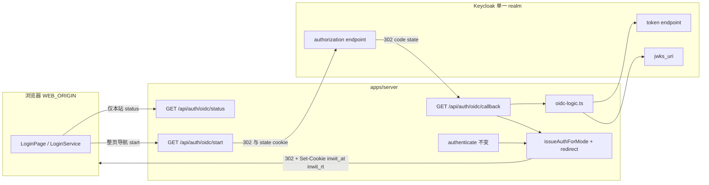
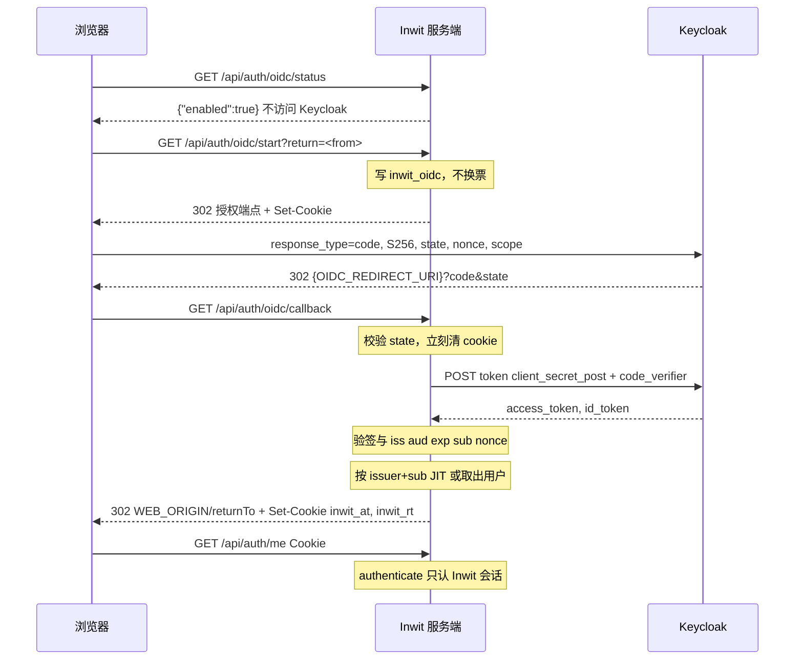
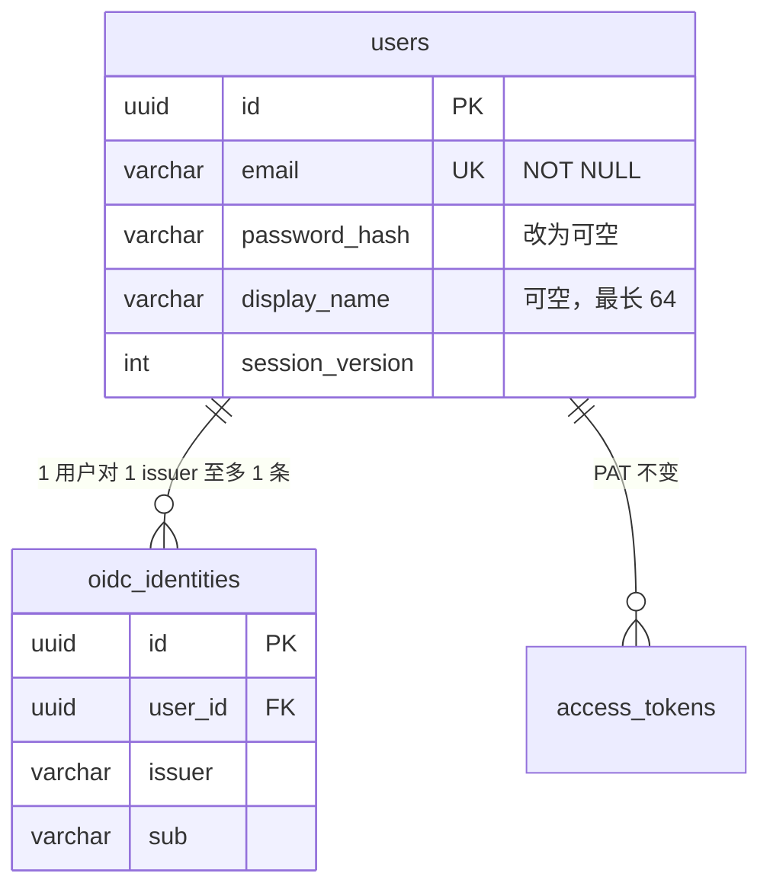

# Inwit 可选 OIDC 登录（Keycloak）

| 项 | 值 |
| --- | --- |
| 作者 | 待定 |
| 日期 | 2026-11-19 |
| 状态 | Draft |
| 落点 | `docs/design/oidc-login.md` |
| 范围 | 设计。不创建 Keycloak client，不连接数据库，不写入任何 secret |

## 概述

Inwit 今天只认自己的会话：邮箱密码登录后签发 `inwit_at` / `inwit_rt`（或非 `WEB_ORIGIN` 时的 bearer），业务 API 一律走 `authenticate`。本设计在此之上加一条可选的 Keycloak 授权码登录。服务端环境变量齐全才启用；缺任一必填项则整条能力关闭，登录页和注册页与现在一致，也不访问 Keycloak。

启用之后，浏览器登录页在保留邮箱密码登录和本地注册的同时，增加「使用统一账号登录」。用户在 Keycloak 完成授权码 + PKCE（S256）后，由 Inwit 服务端用 confidential client 换票，校验本系统 audience 的 access token 和 client id 的 ID token，再按 `(issuer, sub)` 找到或 JIT 创建本地用户，并签发**现有的** Inwit 会话。Keycloak access token 不是 Inwit API 凭证。一次部署只连接一个 realm。

## 背景与现状

共用的 IdP 是 Keycloak 26.8.2。test 与 prod 是同一服务上的两个 realm，账号不互通。发现文档可用。相对 issuer 的端点两边相同：

| 用途 | 路径 |
| --- | --- |
| 发现 | `{issuer}/.well-known/openid-configuration` |
| 授权 | `{issuer}/protocol/openid-connect/auth` |
| 换票 | `{issuer}/protocol/openid-connect/token` |
| JWKS | `{issuer}/protocol/openid-connect/certs` |
| UserInfo | `{issuer}/protocol/openid-connect/userinfo` |
| 登出 | `{issuer}/protocol/openid-connect/logout` |
| 撤销 | `{issuer}/protocol/openid-connect/revoke` |

- prod issuer：`https://super-agent-auth.aimo.plus/realms/super-agent-prod`
- test issuer：`https://super-agent-auth.aimo.plus/realms/super-agent-test`
- 管理控制台：`https://super-agent-auth.aimo.plus/admin`
- 发现文档里的 `registration_endpoint` 不能用。匿名动态注册已关。Inwit 不能替用户自助注册。
- 现有 client `super-agent-native` 只允许回调 `superagent://oauth/callback`，audience 是 `super-agent-api`，prod 和 test 各有一份。Inwit 不得复用该 client、该回调或该 audience。

本地鉴权（以代码为准，不用过期笔记）：

- 路由在 `apps/server/src/auth/auth.routes.ts` 的 `registerAuthRoutes`：`POST /api/auth/register`、`POST /api/auth/login`、`POST /api/auth/refresh`、`POST /api/auth/logout`、`GET /api/auth/me`。注册和登录公开。`registerInputSchema` / `loginInputSchema` 在 `packages/dto/src/user.ts`，都是邮箱 + 至少 8 位密码。
- 密码是 argon2id，`hashPassword` / `verifyPassword` 在 `apps/server/src/auth/password.ts`。
- 会话 JWT 由 `signAccessToken` / `signRefreshToken`（`apps/server/src/auth/token.ts`）用 `JWT_SECRET` 做 HMAC。payload 是 `sub`（Inwit 用户 id）、`type`、`sv`（`users.session_version`）。access 默认 900 秒，refresh 默认 30 天（`apps/server/src/config.ts` 的 `ACCESS_TOKEN_TTL_SECONDS` / `REFRESH_TOKEN_TTL_DAYS`）。
- Cookie 名是 `inwit_at`、`inwit_rt`（`apps/server/src/auth/cookies.ts`）。`httpOnly`、`SameSite=Lax`、`signed`、`path=/`。`secure` 仅当 `NODE_ENV === 'production'`。
- `authModeFromOrigin`（`apps/server/src/auth/auth-logic.ts`）只在请求头 `Origin` **精确等于** `WEB_ORIGIN` 时返回 `cookie`，否则 `tokensForMode` 把 access/refresh 放进 JSON。默认 `WEB_ORIGIN` 是 `http://localhost:5190`。生产示例是 `https://inwit.aimo.plus`（`.env.production.example`）。因此用 `http://127.0.0.1:5190` 登录不会种 cookie。
- `authenticate`（`apps/server/src/auth/authenticate.ts`）先接受 `Authorization: Bearer`。`iwt_` 前缀走 PAT（`isPersonalAccessToken`，`apps/server/src/auth/access-token-logic.ts`），否则当作 Inwit access JWT。没有 Bearer 时读 access cookie，无效再凭 refresh cookie 静默轮换。`sessionVersion` 不一致则拒绝。`POST /api/auth/logout` 在匹配的情况下把 `session_version` 加一，并 `clearAuthCookies`。不调用任何外部 IdP。PAT 不随 session version 作废。
- `users` 在 `apps/server/src/db/schema-auth.ts`。`email varchar(255) NOT NULL`，约束名 `users_email_unique`（`apps/server/drizzle/0000_init.sql`）。`password_hash varchar(255) NOT NULL`。`display_name varchar(64)` 可空。公开 DTO `userSchema.email` 是 `z.string().email()`，不能改成可空而不改所有端。
- Web 没有单独的 `/register`。`ROUTES.login` 是 `/login`（`apps/web/src/routes.ts`）。`apps/web/src/pages/login/index.tsx` 用页内 tab 切换 `LoginService.mode`：`login` | `register`。文案是「进来复习」/「开一个账」。状态在 `LoginService`（`apps/web/src/pages/login/login.service.ts`）和全局 `AuthService`（`apps/web/src/services/auth.service.ts`）。组件不直接 `fetch`。`apps/web/src/api/auth.ts` 经 `request()` → `browserFetch`（`apps/web/src/api/transport.ts`），相对路径、`credentials: 'include'`，禁止 `Authorization`。样式在 `apps/web/src/pages/login/styles.css`，已由 `apps/web/src/style-entry.css` 引入。
- 开发时 Vite 把 `/api` 代理到 `localhost:3020`（`apps/web/vite.config.ts`，`host: 127.0.0.1`，`port: 5190`，`changeOrigin: true`）。浏览器若打开的是 `http://localhost:5190`，`Origin` 才能对上默认 `WEB_ORIGIN`。
- 桌面壳 `apps/desktop/src-tauri/tauri.conf.json`：`identifier` 为 `plus.aimo.inwit`，`devUrl` 为 `http://localhost:5190`，`frontendDist` 为 `https://inwit.aimo.plus`。WebView 加载的就是这个站点，不是带 `plugin-store` 的内嵌包。`apps/web/src/platform/boundaries.test.ts` 禁止 `src/api/` 引用 Tauri、`plugin-store` 和 `Authorization`。`on_navigation`（`apps/desktop/src-tauri/src/lib.rs` 的 `navigation_allowed`）放行全部 `http`/`https`，因此 WebView **可以**整页跳到 Keycloak。v1 已决定不在壳里显示「使用统一账号登录」，也不靠平台去拦这次跳转。`reload_main` 只挂在重新加载菜单上：人还在应用 origin 上就 `reload`，否则 `navigate` 回首页；它不会取消进行中的 OIDC 导航。`on_new_window` 里唯一一次 `open::that` 打开系统浏览器并拒绝新窗口。`apps/desktop/__tests__/tauri.contract.test.mjs` 断言 `open::that` 的源码出现次数是 1，且位于 `on_new_window` 之后，`on_navigation` 里不能出现。旧笔记里的 `inwit-auth.json` bearer 与当前代码不符，以这段代码为准。尽管生产壳的文档 origin 就是 `WEB_ORIGIN`，OIDC 回调仍不能假设 WebView 在离开站点再回来之后还带着 cookie：顶层跨站 GET 的 `Origin` 经常缺失，若误用 `authModeFromOrigin`，回调会走 bearer JSON，浏览器只会看到一坨 token。
- 移动端是另一套 UI：`apps/mobile/app/login.tsx` + `apps/mobile/src/pages/login/login.service.ts`。`AuthService.login` 先 `loginUser`，再调用私有的 `issueOrReusePat()`：按名称 `inwit-mobile` 列出、创建并 `reveal` PAT，写入 `expo-secure-store` 键 `inwit.pat`。`createMobileClient` 把 `getToken` 设为 `readPat()`。`apps/mobile/src/api/client.ts` 的 `persistAuth` 是空函数，登录响应里的 Inwit JWT 被丢掉。`issueOrReusePat` 不接收 JWT，三条 PAT 请求只带当前 PAT。全新安装没有 PAT 时，这三条请求没有 `Authorization`。后续业务请求才是 `Authorization: Bearer <PAT>`。v1 不改这条链路。

错误体系统一是 `AppError.of(status, code)`，文案在 `apps/server/src/errors.ts` 的 `ERROR_MESSAGES`，由 `apps/server/src/plugins/error-handler.ts` 的 `send` 输出 `{ error: { code, message } }`。这个 handler **只 `reply.status().send`，从不 `redirect`**。OIDC 的浏览器导航（`start`、`bind/start`、`callback`）因此不能 `throw AppError`，否则登录页读不到 `oidc_error`，用户看到的是 JSON。`PASSWORD_NOT_SET` 是设置页的 `POST`，继续走 `AppError`。改表必须 `pnpm --filter @inwit/server migrate:generate` 再 `migrate`，禁止手改库。新 HTTP 形状先改 `packages/dto`。`buildApp` 使用 `logger: true`（`apps/server/src/app.ts`）。Fastify 默认请求日志包含 `req.url`，回调上的 `code` 和 `state` 会在任何业务日志之前被写出去。

## 目标与非目标

目标：

1. OIDC 由服务端 env 整体开关。未配置时 Web 登录/注册零视觉差异、零发往 Keycloak 的请求。
2. 已配置时保留本地邮箱密码登录和本地注册，只增加三方登录入口。
3. 一次进程只连一个 issuer。test 部署配 test issuer，prod 部署配 prod issuer。
4. 登录成功后仍签发 Inwit 会话。`authenticate`、PAT、session version 不变。
5. 外部身份的主键是 `(issuer, sub)`。运行时禁止用 email 自动合并已有密码账号。一次性把已有账号导入 Keycloak 的规则在 `docs/design/oidc-account-import.md`：导入当时按邮箱去重，并事先写入 `(issuer, sub)`。
6. client secret 只存在服务端环境。前端只知道「是否启用」和本站开始登录的 URL。
7. v1 交付浏览器（`Origin` / 文档在 `WEB_ORIGIN` 上的 Web）。桌面和移动的原生回调是后续 PR，不在 v1 假装完成。

非目标：

- 运行时不把 Inwit 用户持续同步进 Keycloak。一次性导入见 `docs/design/oidc-account-import.md`。不读不写 PostgreSQL `222.128.65.91:25432` 上的库 `aimo_oidc`（角色 `super_agent_oidc_owner`）。Inwit 的 `PG_*` 仍只指向 Inwit 自己的库。本文不给出该库的口令或连接串。
- 不实现 Keycloak 管理后台，不调用 `registration_endpoint`，不打开自助注册。
- 不替换 PAT，不让 `/api/**` 业务路由接受 Keycloak JWT，也不接受 audience `super-agent-api`。
- 不启用 ROPC（密码模式）或 implicit。
- 不在 v1 做 RP-initiated logout、解绑、或给 JIT 用户补设本地密码。不在 Tauri 壳显示「使用统一账号登录」，也不在 v1 的 WebView 里为 OIDC 强制种 cookie。
- 不在本设计中创建 client 或记录任何真实 secret、管理员密码。

## 方案

### 组件



v1 不在浏览器里换票。浏览器看不到 client secret、授权码的换票结果、或 Keycloak access token。

### Client 形态

Inwit 有自己的服务端，Web 使用 **confidential client**。secret 只放在该部署的服务器环境里，不进 git，不进 Vite 的 `VITE_*`，不进桌面壳，不进移动端。

仍强制 PKCE S256。confidential 不能代替 PKCE：授权码会经过浏览器地址栏和可能的代理日志，PKCE 让截获的 code 无法单独换票。`code_challenge_method` 只接受 `S256`，拒绝 `plain`。

只开标准授权码。`response_type=code`。不开 `directAccessGrantsEnabled`（ROPC），不开 `implicitFlowEnabled`。不请求 `offline_access`。Keycloak 若仍返回 refresh token，服务端丢弃，不落库、不写日志。

换票使用 **`client_secret_post`**（表单体字段 `client_secret`），不用 `client_secret_basic`。Keycloak 生成的 secret 可能含 `:` 或非 unreserved 字符；HTTP Basic 要求先按 application/x-www-form-urlencoded 编码 `id:secret` 再 base64，这一步经常变成 `invalid_client`。表单字段由我们自己编码一次即可。实现不得记录这次 POST 的 body。两种方法 Keycloak 都支持；选定 post 是为了少一个编码坑，不是为了把 secret 放到 query string。禁止把 secret 放进 URL。

建议 clientId：两个 realm 都用 `inwit`（允许同名，因为 realm 隔离）。禁止配置成 `super-agent-native`。audience 建议 `inwit-api`，禁止 `super-agent-api`。理由：资源服务器靠 audience 区分 token 是发给谁的。复用 `super-agent-api` 会让 Super Agent 的 access token 在校验规则上和 Inwit 混淆，也会让运维分不清令牌边界。ID token 的 `aud` 按 OIDC 必须是 client id（`inwit`），API audience 只通过 audience mapper 写进 **access token**，不写进 ID token。ID token 只证明这次登录，不能当 API 凭证。

### 环境变量与开关

沿用 `apps/server/src/config.ts` 的风格：`SCREAMING_SNAKE`，空字符串用现有 `blankToUndef` 当成未设置。五个字段在 Zod 里都是 **optional**。不能做成必填，否则现有 vitest 对 `config` 的 mock、以及没配 OIDC 的本地进程会在 `envSchema.parse` 直接起不来。是否启用由纯函数判断，不由「进程里有没有这个键」单独决定。

必填，缺一则整体关闭：

| 变量 | 含义 |
| --- | --- |
| `OIDC_ISSUER` | 该部署唯一的 issuer，无 query、无 userinfo、https。不要末尾斜杠。test 填 test issuer，prod 填 prod issuer |
| `OIDC_CLIENT_ID` | confidential client id，建议 `inwit` |
| `OIDC_CLIENT_SECRET` | 只放服务器。长度至少 16 |
| `OIDC_REDIRECT_URI` | 精确回调，见下表。必须与 `WEB_ORIGIN` 同源，路径必须是 `/api/auth/oidc/callback`，无 query、无 hash |
| `OIDC_AUDIENCE` | access token 必须包含的 audience，建议 `inwit-api`。不设默认值，避免 mapper 忘了配却悄悄用错受众 |

可选：

| 变量 | 默认 | 约束 |
| --- | --- | --- |
| `OIDC_SCOPES` | `openid profile email` | 未设置用默认。一旦设置，必须同时含 `openid`、`profile`、`email`，且不得含 `offline_access`。不满足则与缺少 `OIDC_CLIENT_SECRET` 一样整能力关闭 |

齐全的额外校验（任一失败也视为未启用，启动打 error，列出**变量名**而不是值）：

- `OIDC_ISSUER` 的 host 必须是 https，且 URL 不含用户名口令。
- `NODE_ENV=production` 时 `OIDC_REDIRECT_URI` 必须是 https。开发环境只允许 `http://localhost:5190/api/auth/oidc/callback` 这种与 `WEB_ORIGIN` 一致的 localhost（不要写成 `127.0.0.1`，因为 `authModeFromOrigin` 和本设计的回调 origin 都要求精确等于 `WEB_ORIGIN`）。
- `OIDC_CLIENT_ID !== 'super-agent-native'`。
- `OIDC_AUDIENCE !== 'super-agent-api'`。
- `OIDC_SCOPES` 若非空，缺 `openid` / `profile` / `email` 之一，或含 `offline_access`：关闭，日志只写变量名 `OIDC_SCOPES`，不写 scope 串以外的秘密（scope 本身不是秘密，但不要因此去请求 Keycloak）。
- 五个都空：关闭，打一条 info，不当成配置错误。`OIDC_SCOPES` 单独出现而五个必填都空，也只是关闭，不算半配置去跳转。
- 只填了一部分，或填了但校验失败（含非法 `OIDC_SCOPES`）：关闭，打 error。不要带着半套配置去跳转 Keycloak。

没有单独的 `OIDC_ENABLED=true`。配齐即开，拆掉即关。test 和 prod 不是运行时开关，就是两套部署各自的 env。一个进程里不得保存第二个 issuer，也不得提供 realm 切换参数。

回调（写进对应 client 的 `redirectUris`，禁止通配符）：

| 部署 | `OIDC_REDIRECT_URI` |
| --- | --- |
| 生产 | `https://inwit.aimo.plus/api/auth/oidc/callback` |
| 本地，对着 **test** realm | `http://localhost:5190/api/auth/oidc/callback` |

生产 client 不要登记 localhost。本地 Vite 监听 `127.0.0.1:5190`，但开发者必须用 `http://localhost:5190` 打开页面，否则 `Origin` 对不上 `WEB_ORIGIN`，现有密码登录已经不会种 cookie；OIDC 回调同样只认配置的那一个 URI。

`apps/web` 不增加任何 OIDC env。启用与否只来自本站 `GET /api/auth/oidc/status`。

### 发现文档、JWKS、state

发现与 JWKS 只在 OIDC 已启用且用户真正开始登录（或绑定）时拉取。`GET /api/auth/oidc/status` 不访问 Keycloak。进程启动不因发现失败而退出。worker 不拉发现文档。

缓存放进程内存即可。登录是人机速率，单部署远低于 1 次/秒，不引入 Redis。

- 发现文档 TTL 1 小时。缓存键是配置的 issuer。文档里的 `issuer` 必须与配置逐字相等（配置入库前去掉一个末尾 `/`）。`authorization_endpoint`、`token_endpoint`、`jwks_uri` 必须是 https、host 与 issuer 相同、且位于 issuer 路径之下。发现、JWKS 和 token POST 的 `fetch` 都设 `redirect: 'error'`（不要用默认的 `follow`）。`307`/`308` 会把带 `client_secret` 的表单重放到下一跳，而那一跳可以是发现文档检查看不见的另一台主机。任何 3xx 都当成 `OIDC_UNAVAILABLE`，不记录 body。超时：发现和 JWKS 5 秒，token POST 10 秒。
- 签名算法允许集 = 发现文档的 `id_token_signing_alg_values_supported` ∩ `{RS256, RS384, RS512, PS256, PS384, PS512, ES256, ES384, ES512, EdDSA}`。该字段缺失时只允许 `RS256`（现网 access token 的算法），并打 warn。`none` 和全部 `HS*` 永远拒绝，即使发现文档列出它们。本设计不使用对称密钥验 Keycloak token。
- JWKS 用 `jose` 的 `createRemoteJWKSet`（`apps/server` 新增依赖 `jose`，现有 `jsonwebtoken` 只继续签 Inwit HMAC，不拿来验 RS256）。`cooldownDuration` 30 秒，避免未知 `kid` 被打成放大请求。缓存约 10 分钟。验签时 `algorithms` 传入上面的允许集，不拿 token 头里的 `alg` 去选密钥类型。`kid` 对不上就刷新一次；仍对不上则失败。
- 时钟偏差 60 秒，同时用于 `exp` 和 `nbf`。

事务 cookie 一个就够，避免 state / nonce / verifier 各写各的、回跳时丢一半：

- 名：`inwit_oidc`
- 值：Fastify cookie 签名（沿用 `COOKIE_SECRET`）后的 JSON：`state`、`nonce`、`verifier`、`mode`（`login` 或 `bind`）、`returnTo`、`iat`
- `httpOnly`、`SameSite=Lax`、`path=/api/auth/oidc`、`maxAge=600`、生产 `secure`
- 不设 `Domain`，host-only，避免子域带走
- `SameSite=Strict` 不行：从 Keycloak 顶层跨站 GET 回来时浏览器不会带上 Strict cookie，所有登录都会 state 失败
- `state`、`nonce`、`verifier` 各 32 字节 `base64url`。`code_challenge = BASE64URL(SHA256(verifier))`
- 比较 `state` 用 `timingSafeEqual`。先比字节长度，长度不同直接视为不匹配。`crypto.timingSafeEqual` 在长度不同时会抛错，那个异常若逃到 `error-handler` 会变成 JSON 500，并且可能来不及清 cookie
- 回调一进来就清除该 cookie，再换票。失败也不能留下可重放的 verifier

`returnTo` 只允许站内相对路径。用 `new URL(returnTo, WEB_ORIGIN)` 解析后，origin 必须等于 `WEB_ORIGIN`，路径不得以 `/api/auth/oidc` 开头，长度 ≤ 512，拒绝 `//`、反斜杠和带 scheme 的字符串。非法则落到 `/`。存进 cookie 和最终 `Location` 的是 `pathname + search`，不要只留 pathname，否则 `/docs?doc=…` 会丢查询串。这是防开放重定向，不是防 Keycloak。

CSRF：攻击者不能把自己的 code 塞进受害者的回调，因为 verifier 和 state 在受害者的 host-only cookie 里，且 PKCE 绑在这一对上。登录 CSRF（诱使用户点开 start）只会让用户登上**他自己的** Keycloak 账号，不能把用户绑到攻击者的 sub。绑定还要求回调时 Inwit 会话仍有效。

### Web 登录序列



`start` 必须是浏览器整页导航（`window.location.assign`），不能 `fetch`。`fetch` 跟不到 Keycloak 的跨站 302，也留不住只在顶层导航里需要的 Lax cookie。

回调种 Inwit 会话时 **不要** 调用 `authModeFromOrigin`。顶层回跳常常没有 `Origin: https://inwit.aimo.plus`。只要这次请求打到已配置的 `OIDC_REDIRECT_URI`（路径固定、部署只配一个），就调用 `issueAuthForMode(reply, user.id, user.sessionVersion, 'cookie')`，丢掉它返回的 token 字符串，然后 `reply.redirect` 到 `WEB_ORIGIN + returnTo`。不要 `reply.send`，也不要把返回值写进 body。`issueAuthForMode` 在 `apps/server/src/auth/auth.service.ts` 的签名就是 `(reply, userId, sessionVersion, mode)`，cookie 模式下它会 `setAccessCookie` / `setRefreshCookie`，同时仍然把原始 token 对返回给调用方。JIT 新建、再次登录已有 `(issuer, sub)`、绑定成功，都走这一段。不要改成 `issueAuthResponse`：它会返回 `AuthResponse`，把返回值发出去就变成 JSON，不再是纯 302。`tokensForMode('cookie', …)` 虽是 `undefined`，挡不住这次多出来的 body。Location 必须用配置的 `WEB_ORIGIN` 拼，不能用 Vite 代理改写后的 `Host`（代理 `changeOrigin` 会让上游看到 `localhost:3020`）。相对 Location `/` 在浏览器侧会落回用户打开的 host；为避免 dev 代理把人送到 `:3020`，仍然发绝对地址。

`inwit_at` / `inwit_rt` 的属性继续走 `setAccessCookie` / `setRefreshCookie`，不新造一套会话 cookie。

### 回调验票

纯判断放进 `apps/server/src/auth/oidc-logic.ts`，无 I/O。HTTP、JWKS 和数据库留在 `oidc.service.ts`。伪代码：

```text
redirect(code, mode):
  若 cookie 还在，先清 inwit_oidc
  页面 = mode == bind 且 code 不是 OIDC_BIND_SESSION ? /settings/profile : /login
  若 code 非空，query oidc_error=code
  reply.redirect(WEB_ORIGIN + 页面)     # 不 throw，不经过 error-handler

on start:
  if !oidcEnabled: redirect(无 code) 到 /login，不发任何出站请求
  if !consumeLoginIp: redirect(RATE_LIMITED)
  doc = discovery()                     # fetch redirect:'error'；失败则 redirect OIDC_UNAVAILABLE
  写 inwit_oidc
  reply.redirect(授权端点)

on callback:
  try:
    tx = readSignedCookie(inwit_oidc)
    clear inwit_oidc                    # 先清，再做任何可能抛错的事
    mode = tx.mode 或 login
    if tx missing or expired or mode 非法: redirect OIDC_STATE
    if query.error: redirect OIDC_DENIED          # 不把 error_description 放进 Location
    if query.state 缺失或字节长度与 tx.state 不同: redirect OIDC_STATE
    else if !timingSafeEqual: redirect OIDC_STATE
    if query.code missing or length > 2048: redirect OIDC_DENIED
    if !consumeLoginIp: redirect RATE_LIMITED

    doc = discovery(config.issuer)      # 端点必须落在 issuer host；3xx = OIDC_UNAVAILABLE
    form = {
      grant_type: authorization_code,
      code: query.code,
      redirect_uri: config.redirectUri,
      client_id: config.clientId,
      code_verifier: tx.verifier,
      client_secret: config.clientSecret
    }
    tokens = POST doc.token_endpoint form   # redirect:'error'；不记录 body 和响应里的 token
    if tokens 没有 access_token 或 id_token: redirect OIDC_DENIED
    丢弃 refresh_token

    algs = allowedAlgs(doc)
    access = jwtVerify(...)               # 失败则 redirect 对应 code，不 throw AppError
    id = jwtVerify(...)
    claims = profileFromIdToken(id)       # 只读 ID token，v1 不调 userinfo
    if mode == login: user = upsertLogin(...)  # 已有 (issuer, sub) 不改资料；与新建同一签发
    if mode == bind:
      result = linkToCurrentSession(...)
      if result.error: redirect result.error   # TAKEN / EXISTS / BIND_SESSION，302，不 throw
      user = result.user
    issueAuthForMode(reply, user.id, user.sessionVersion, 'cookie')
    丢掉返回的 accessToken / refreshToken
    reply.redirect(WEB_ORIGIN + returnTo) # 无 JSON body。不要调用 issueAuthResponse
  catch 任何还没 redirect 的异常:
    clear inwit_oidc
    redirect OIDC_UNAVAILABLE             # 仍然是 302，不是 error-handler 的 JSON
```

`jwtVerify` 的 `algorithms` 必须显式传入。先 `decodeProtectedHeader`：缺 `alg`、`alg=none`、或不在允许集，直接失败，不能落到「库的默认」。密钥只来自该 issuer 的 `jwks_uri`，`use=sig`，`kid` 匹配，`kty` 与算法族一致（RSA 对 RS/PS，EC 对 ES，OKP 对 EdDSA）。

v1 不调用 UserInfo。email、`name`、`preferred_username` 只从 ID token 读。Keycloak 的 email / profile scope 默认会把这些声明放进 ID token。若 mapper 被改成只写 access token，本设计把 email 视为缺失并走占位，而不是去读 access token 里的 profile。access token 只承担 `iss` / `aud` / `exp` / `sub` / 签名。

不在 `authenticate` 里增加第二条验签路径。Keycloak token 不是 `iwt_`，会掉进 `verifyToken`，用 `JWT_SECRET` 做 HMAC 验签，结果是 `INVALID_TOKEN`。保持这个失败方式，避免业务 API 误收 RS256。

### 数据模型



`password_hash` 今天是 `NOT NULL`。OIDC 用户没有本地密码。迁移把该列改成可空。**NULL 表示不能本地密码登录**，不要写空字符串，也不要写一段假的 argon2（`verifyPassword` 对非法 hash 会抛错，最后变成 500）。

`apps/server/src/db/schema-auth.ts` 的 `passwordHash` 去掉 `.notNull()`。预期 SQL（由 drizzle-kit 生成，不要手改已经应用的库）：

```sql
ALTER TABLE "users" ALTER COLUMN "password_hash" DROP NOT NULL;
```

现有行都有 hash，迁移向后兼容。回滚这条 `SET NOT NULL` 之前，必须没有 NULL。

新表放在同一文件，并从 `apps/server/src/db/schema.ts` 再导出：

```ts
export const oidcIdentities = pgTable(
  'oidc_identities',
  {
    id: uuid('id').primaryKey().defaultRandom(),
    userId: uuid('user_id')
      .notNull()
      .references(() => users.id, { onDelete: 'cascade' }),
    issuer: varchar('issuer', { length: 512 }).notNull(),
    sub: varchar('sub', { length: 255 }).notNull(),
    createdAt: timestamptz('created_at').notNull().defaultNow(),
    updatedAt: timestamptz('updated_at').notNull().defaultNow(),
  },
  (t) => [
    uniqueIndex('oidc_identities_issuer_sub_uidx').on(t.issuer, t.sub),
    uniqueIndex('oidc_identities_user_issuer_uidx').on(t.userId, t.issuer),
  ],
);
```

`(issuer, sub)` 全局唯一，这是外部身份。`(user_id, issuer)` 唯一：一个 Inwit 用户在一个 issuer 下至多一个 sub。一个用户可以在表里拥有不同 issuer 的行，但一个部署只会写入自己配置的那一个 issuer。换 realm 后 `sub` 会变，不能把 test 的 sub 当成 prod 的同一个人。删除用户时身份行级联删除。

不在 `users` 上加 `issuer` / `sub` 列。本地密码用户可以没有身份行。

JIT（`mode=login`，且不存在 `(issuer, sub)`），一个事务：

1. `displayName`：ID token 的 `name`，空白则 `preferred_username`，再空白则 SQL NULL。trim 后按 Unicode 码位截到 64，与 `display_name varchar(64)` 和 `updateProfileInputSchema` 一致。以后再次登录**不覆盖**已有 `displayName`，避免冲掉用户在设置里改过的名字。
2. email：
   - ID token 没有 `email`：使用占位地址，不报错。
   - `email` 有值但不是合法邮箱，或超过 255：失败 `OIDC_EMAIL_INVALID`，不建用户。不把原值写进日志。
   - 合法则 `trim().toLowerCase()`。若 `users.email` 已被占用：失败 `OIDC_EMAIL_CONFLICT`，**不**把身份挂到那一行，也**不**比对密码。这是防账号接管。用户必须先用邮箱密码登录，再走显式绑定。
3. 占位邮箱：`oidc.` + `sha256(issuer + "\n" + sub)` 的 64 位 hex + `@users.inwit.invalid`。`.invalid` 是保留 TLD，不会成为真实投递域。长度约 90，小于 255，能通过 `userSchema` 的 `z.string().email()`。`AuthService.displayLabel` 先用 `displayName`，没有名字时才会露出这串地址。
4. `passwordHash: null`。`sessionVersion` 用列默认 0。
5. 插入 `oidc_identities`。email 唯一冲突（含并发）映射为 `OIDC_EMAIL_CONFLICT` 并整事务回滚。`(issuer, sub)` 并发冲突则重新读身份行并登录该用户，不新建第二份。

再次登录已存在的 `(issuer, sub)`：不改 email、不改 displayName、不改 password，返回这一行。回调与 JIT 新建成功走同一段：`issueAuthForMode(reply, user.id, user.sessionVersion, 'cookie')`，丢掉返回的 token 字符串，再 `reply.redirect` 到 `WEB_ORIGIN + returnTo`。不要调用 `issueAuthResponse`，也不要 `reply.send`。若该用户的 email 仍是占位，而这次 ID token 带来了新的合法邮箱，**仍然不自动写入**。自动改邮箱会在「占位 → 别人的邮箱」上打开接管窗口。用户可在设置里自己改（现有 `updateProfile` 已做 `EMAIL_TAKEN` 检查）。

`verifyPassword(plain: string, hash: string)` 的两个调用点是 `loginUser`（`apps/server/src/auth/auth.service.ts`）和 `changePassword`（`apps/server/src/users/users.service.ts`）。列一改成可空，`UserRow.passwordHash` 就是 `string | null`，这两处不改则 `pnpm typecheck` 失败。空 hash 守卫因此和迁移放在同一次合并（PR 1），不拖到出现 JIT 的 PR 2。现有行都非空，守卫不改变今天的成功登录。

本地登录必须在验密前拒绝空 hash，否则 argon2 抛错会变成 500：

```ts
if (!row?.passwordHash || !(await verifyPassword(input.password, row.passwordHash))) {
  throw AppError.of(401, 'INVALID_CREDENTIALS');
}
```

对外仍是「邮箱或密码错误」，不透露这是 OIDC 用户。注册接口今天就会用 `EMAIL_ALREADY_REGISTERED` 暴露邮箱是否存在，登录侧不再加一个新的提示。桌面和移动端 v1 没有第二条入口，所以 JIT 用户在这两端看到的就是这句，和密码打错无法区分。见「桌面与移动」。

`changePassword`（`apps/server/src/users/users.service.ts`）在 `verifyPassword` 之前：

```ts
if (!current.passwordHash) throw AppError.of(400, 'PASSWORD_NOT_SET');
```

文案：「此账号没有本地密码」。这是唯一继续 `throw AppError` 的新错误，因为 `POST /api/me/password` 是设置页的 JSON 请求，不是顶层导航。v1 不提供「已登录后设置首个密码」。那需要一条不核对旧密码的新接口，超出这次范围。因此 JIT 用户在桌面和移动端没有自救路径，直到后续 PR 要么加上设密，要么送上原生 OIDC。

### 显式绑定

已有密码用户要关联外部身份时，必须已经登录。禁止在匿名回调里因为 email 相同就绑定。

`GET /api/auth/oidc/bind/start` 不加 `preHandler: [app.authenticate]`。那个 preHandler 抛 `AppError`，浏览器会看到 JSON 401。路由自己读 `inwit_at` / `inwit_rt`，规则与 `authenticate` 相同；没有会话就 `redirect` 到 `/login?oidc_error=OIDC_BIND_SESSION`，不 JIT。有会话且 OIDC 启用时，写入 `mode=bind` 的 `inwit_oidc`，302 到同一授权端点。`returnTo` 默认 `/settings/profile`。未启用则 302 回 `/settings/profile`，不访问 Keycloak。

回调 `mode=bind`：

- 用与 `authenticate` 相同的 cookie 规则认出当前用户（access cookie，不行再用 refresh cookie 轮换）。会话没了则 `OIDC_BIND_SESSION`，**不要**降级成 JIT 登录。
- `(issuer, sub)` 已属于当前用户：幂等成功。与 JIT 一样调用 `issueAuthForMode(reply, user.id, user.sessionVersion, 'cookie')`，丢掉返回值，再 `reply.redirect` 到 `WEB_ORIGIN + returnTo`（默认 `/settings/profile`）。不要调用 `issueAuthResponse`。
- 属于别的用户：`redirect` 到 `/settings/profile?oidc_error=OIDC_IDENTITY_TAKEN`。这是 302 的 query，不是 HTTP 409，也不要 `throw AppError`。`error-handler` 只会把 `AppError` 写成 JSON。
- 当前用户在该 issuer 下已有另一个 sub：`redirect` 到 `/settings/profile?oidc_error=OIDC_IDENTITY_EXISTS`。同样是 302，不是 409。
- 否则插入身份行。不改 `password_hash`，不改 email。成功后同样 `issueAuthForMode(..., 'cookie')` 再 `reply.redirect`。

绑定过程中若 access cookie 在 15 分钟内过期，refresh cookie 仍可轮换。两者都无效就让用户重新登录再绑。

v1 没有解绑 API。解绑会留下 `password_hash IS NULL` 的用户且无法登录。要做解绑必须先有「设置本地密码」。

### API

契约放在 `packages/dto/src/user.ts`，由 `packages/dto/src/index.ts` 已有的 `export * from './user.js'` 带出。不改 `userSchema`：`hasPassword` 若塞进每个 `User`，会碰到所有 fixture，而登录页其实只需要一个布尔。

```ts
export const oidcStatusSchema = z.object({
  enabled: z.boolean(),
});
export type OidcStatus = z.infer<typeof oidcStatusSchema>;

export const oidcAccountSchema = z.object({
  enabled: z.boolean(),
  linked: z.boolean(),
  hasPassword: z.boolean(),
  emailSynthetic: z.boolean(),
});
export type OidcAccount = z.infer<typeof oidcAccountSchema>;
```

| 方法与路径 | 鉴权 | 行为 |
| --- | --- | --- |
| `GET /api/auth/oidc/status` | 无 | `{ enabled }`。不访问 Keycloak。未启用也是 200 JSON。这是唯一用 JSON 表示「关」的 OIDC 路由 |
| `GET /api/auth/oidc/start?return=` | 无 | 未启用：302 `/login`，无 `oidc_error`，不访问 Keycloak。启用：302 到 Keycloak。`return` 经 `returnTo` 规则过滤 |
| `GET /api/auth/oidc/callback` | cookie 事务 | 见验票。成功和失败都是 302，没有 JSON body |
| `GET /api/auth/oidc/bind/start?return=` | 自己认 cookie，不挂 `authenticate` | `mode=bind`。无会话则 302 `/login?oidc_error=OIDC_BIND_SESSION` |
| `GET /api/me/oidc` | `authenticate` | `oidcAccountSchema`。这是设置页的 XHR，失败可以是 JSON。未启用时 `{ enabled:false, linked:false, hasPassword, emailSynthetic }` |

`hasPassword` 是 `password_hash IS NOT NULL`。`emailSynthetic` 是邮箱以 `@users.inwit.invalid` 结尾且以 `oidc.` 开头。`linked` 是存在 `issuer = 配置 issuer` 的身份行；未启用时恒为 false。

浏览器导航的失败由路由调用 `reply.redirect`，不把 code 放进 `ERROR_MESSAGES`，也不 `throw`。`error-handler` 碰不到这些响应。query 只放 code，不放自由文本。登录类失败到 `/login?oidc_error=CODE`。这次导航已经丢掉 `location.state`，失败页不试图恢复 `from`。绑定类失败到 `/settings/profile?oidc_error=CODE`，但 `OIDC_BIND_SESSION` 到 `/login`。`OIDC_IDENTITY_TAKEN` 与 `OIDC_IDENTITY_EXISTS` 只出现在这条 302 的 `oidc_error` 上，不是 HTTP 409，也不进入 `ERROR_MESSAGES`。成功不带 token，只 302 到允许过的 `returnTo`（登录开始时传入的 `from`，或绑定默认的 `/settings/profile`）。成功签发一律是 `issueAuthForMode(reply, user.id, user.sessionVersion, 'cookie')` 然后 `reply.redirect`，包括再次登录已有 `(issuer, sub)` 和绑定成功。

SPA 文案（`LoginService.noteOidcError` 与设置页各有一份相同映射）：

| `oidc_error` | 用户可见中文 |
| --- | --- |
| `OIDC_STATE` | 登录已失效，请重新发起 |
| `OIDC_DENIED` | 统一账号登录被拒绝。若账号已停用，请联系管理员 |
| `OIDC_UNAVAILABLE` | 暂时无法连接统一账号服务，请稍后再试 |
| `OIDC_SUBJECT` | 统一账号没有返回用户标识。请联系管理员检查 basic scope |
| `OIDC_AUDIENCE` | 统一账号令牌不能用于本系统。请联系管理员检查受众 |
| `OIDC_EMAIL_CONFLICT` | 该邮箱已有 Inwit 账号。请先用邮箱和密码登录，再在设置中绑定统一账号 |
| `OIDC_EMAIL_INVALID` | 统一账号的邮箱无法使用，请联系管理员 |
| `OIDC_IDENTITY_TAKEN` | 这个统一账号已经绑定了另一个用户 |
| `OIDC_IDENTITY_EXISTS` | 当前用户已经绑定了另一个统一账号 |
| `OIDC_BIND_SESSION` | 绑定需要保持登录。请重新登录后再试 |
| `RATE_LIMITED` | 请求过于频繁，请稍后再试 |

只有 `PASSWORD_NOT_SET` 进入 `ERROR_MESSAGES`，HTTP 400，JSON `{ error: { code, message } }`，文案「此账号没有本地密码」。`RATE_LIMITED` 这个 code 已经存在；OIDC 导航复用它，但是 302 而不是 429 JSON。

路由放在新文件 `apps/server/src/auth/oidc.routes.ts`，由 `buildApp` 紧挨 `registerAuthRoutes` 注册。`auth.routes.ts` 继续只做密码登录。路由保持薄：parse query（DTO）、调用 service、自己 `redirect`。service 用结果对象表示业务失败，不抛 `AppError`。路由再用 try/catch 兜底：任何还没发出的异常都清 `inwit_oidc` 并 302 `OIDC_UNAVAILABLE`。

限流不调用 `assertLoginRateLimit(ip, email)`。那个函数同时消耗 `login:ip:`（20 次 / 15 分钟）和 `login:email:`（10 次 / 15 分钟），而且会 `throw AppError.of(429, 'RATE_LIMITED')`。OIDC 开始时还没有邮箱，用假邮箱会把所有 OIDC 尝试打进同一个 email 桶。`consume` 今天是私有的。新增只消耗 `login:ip:` 的 `consumeLoginIp(ip): boolean`，并让 `assertLoginRateLimit` 的 IP 半边改调它，桶名保持 `login:ip:`，这样密码登录和 OIDC 共用 20 次上限。`start`、`bind/start`、`callback` 在 `consumeLoginIp` 返回 false 时 `redirect` `RATE_LIMITED`，不抛。`NODE_ENV === 'test'` 时在路由里跳过，与 `auth.routes.ts` 今天跳过 `assertLoginRateLimit` 的位置一样，limiter 内部不看环境。

改了路由后跑 `pnpm gen:inwit-skill`，更新 `skills/inwit/references/`。

### Web UI

未启用，或 status 请求失败：不渲染按钮、不渲染分隔线、不请求发现文档、不分配 Keycloak URL。`oidcEnabled === true` 才出现入口，避免先闪一下再消失。Tauri（`isTauriRuntime()`，`apps/web/src/platform/runtime.ts`）v1 **不渲染、也不请求 status**。登录页可以引 `runtime.ts`，不可以在 `src/api/` 里引它（`boundaries.test.ts`）。

启用且不是 Tauri 时，`LoginService` 增加：

- `oidcEnabled: boolean`，初始 false
- `oidcError: string | null`
- `loadOidc()`：`getOidcStatus()`，失败当 false
- `startOidc(returnTo: string)`：`window.location.assign('/api/auth/oidc/start?return=' + encodeURIComponent(safePath))`
- `noteOidcError(code: string | null)`：把 query code 映射成上表中文

按钮调用 `startOidc(from)`。`from` 就是 `LoginContent` 已经算好的那个值：`location.state.from`，缺省 `ROUTES.home`，若等于 `ROUTES.login` 则改成 `ROUTES.home`（`apps/web/src/pages/login/index.tsx`）。密码登录靠 `auth.user` 出现后 `navigate(from)`，OIDC 是整页离开，`location.state` 不会留下来。服务端把这个 `from` 放进 `returnTo` 再 302 回去，两条路径才落到同一页。失败时只回 `/login?oidc_error=`，不恢复 `from`。

`apps/web/src/api/auth.ts` 增加 `getOidcStatus()`，仍走 `request()`。开始登录不是 `fetch`。组件只调用 service。

`LoginContent` 在现有 `<form>` **下面**加一块，登录 tab 和注册 tab 都显示，因为注册只是同一页的 `mode`，不是另一个路由：

- 按钮文案：`使用统一账号登录`
- 说明：`使用管理员已经开通的统一账号。这里不会注册新账号。`
- 本地表单、tab、「登录」/「注册并进入」保持不动

注册 tab 上的这个按钮仍然是登录，不是「去 Keycloak 注册」。没账号的人要管理员在**该部署对应的 realm** 里建号。本地「注册并进入」仍调用 `POST /api/auth/register`。

样式只改 `apps/web/src/pages/login/styles.css`（已在 `style-entry.css` 登记）。类名用 `auth-oidc` 前缀。不要写进 `apps/web/src/styles.css`。

设置页 `apps/web/src/pages/settings/index.tsx` 个人资料区（`section === 'profile'`，密码表单 class `profile-password`）在 OIDC 启用时增加一块，样式放 `apps/web/src/pages/settings/styles.css`：

- 数据来自 `GET /api/me/oidc`，由 `apps/web/src/pages/settings/` 里现有的 settings service 拉取，不在组件里 `fetch`。
- `linked === false`：按钮「绑定统一账号」，导航到 `/api/auth/oidc/bind/start?return=/settings/profile`。
- `linked === true`：文案「已绑定统一账号」。不展示 `sub` 和 issuer。
- `hasPassword === false`：不渲染当前密码表单，改为一句「此账号没有本地密码」。
- `emailSynthetic === true`：邮箱字段下提示「统一账号没有提供邮箱，请填写一个可用的邮箱」。保存仍走现有 `PATCH /api/me`。
- `oidc_error` query 用同一套中文，显示在资料区，不使用 `window.alert`。

移动端 `apps/mobile/app/login.tsx` v1 不改。

### 登出

v1 **不**调用 Keycloak `end_session`，也 **不**调用 revoke。`POST /api/auth/logout` 保持现在的行为：`logoutSession` 增加 `session_version`，`clearAuthCookies`。Web `AuthService.logout` 继续只调 `logoutUser()`。

不做的风险：Inwit 会话没了，Keycloak SSO 还在。同一浏览器里再点「使用统一账号登录」，Keycloak 可能不再问密码，直接发 code。共享电脑上，下一个人会进入前一个 Keycloak 用户的 Inwit 账号。同时，若调用 end_session，会把同一 realm 上的其他系统（包括 Super Agent）一起登出，影响面超出 Inwit。用户于 2026-11-19 决定：v1 只清 Inwit，不调用 `end_session`，不做 RP-initiated logout，不为登出保存 ID token。共享电脑上的 SSO 残留是已知风险，不是 v1 功能。以后若要消掉它，必须另做 RP-initiated logout，并接受它会结束该 realm 的 SSO。

Inwit 不保存 Keycloak refresh token，因此也没有东西可 revoke。

### 失败模式

日志用现有 pino（`req.log`），结构化字段可以有：`oidcError`、`issuerHost`、`alg`、`kid`、`audOk`、`subPresent`、`mode`。禁止记录：access token、ID token、refresh token、authorization code、`client_secret`、PKCE verifier、state、nonce、cookie 值、管理员口令。email 冲突只记 `emailConflict: true`，不记邮箱本身。

`logger: true` 的默认请求行会在路由代码之前记下完整 `req.url`。把 `buildApp` 的 logger 改成带 `req` serializer 的选项对象：保留 Fastify 默认字段（`method`、`url`、`host`、`remoteAddress`，socket 存在时还有 `remotePort`），但 `url` 先经过 `redactOidcUrl`。只处理路径以 `/api/auth/oidc` 开头的 URL，把 query 里的 `code`、`state`、`session_state`、`login_code` 换成 `[redacted]`。不要把这些路由的 `logLevel` 设成 `silent`，那会把上面的 `req.log` 结构化行一起丢掉。响应上的 `Set-Cookie` 不在默认请求行里，verifier 不会因此漏出。PKCE 让单独泄漏的 code 换不了票，但请求行仍然必须打码。

| 情况 | 用户看到 | 日志 |
| --- | --- | --- |
| state 缺失、过期、不匹配，或 nonce 不匹配 | 登录已失效，请重新发起 | `oidcError=OIDC_STATE` |
| 用户取消，或 Keycloak 返回 `access_denied` / `invalid_grant`（含账号禁用） | 统一账号登录被拒绝。若账号已停用，请联系管理员 | `oidcError=OIDC_DENIED`，可加 Keycloak 的 `error` 短码，不加 `error_description` |
| 发现文档、JWKS 或 token 端点超时、非 200、端点 host 不对 | 暂时无法连接统一账号服务，请稍后再试 | `oidcError=OIDC_UNAVAILABLE`，带 `status` 和 `issuerHost`，不带 body |
| issuer 配错 realm，发现文档或 token 的 `iss` 不一致 | 同上，对外不区分「配错」和「宕机」，避免把内部拓扑讲给用户 | `oidcError=OIDC_UNAVAILABLE`，`reason=issuer_mismatch` |
| 忘了 basic scope，access token 没有 `sub` | 统一账号没有返回用户标识。请联系管理员检查 basic scope | `subPresent=false` |
| 忘了 audience mapper，或 aud 只有 `super-agent-api` / 只有 client id | 统一账号令牌不能用于本系统。请联系管理员检查受众 | `audOk=false`，`alg`，不记录 aud 原文以外的 token |
| `alg=none`、HMAC，或 alg 不在允许集 | 与受众失败相同的对外句子 | `alg` 字段写实际 alg |
| 时钟偏差超过 60 秒，`exp`/`nbf` 失败 | 登录已失效，请重新发起 | `reason=clock` |
| email 撞上 `users_email_unique` | 该邮箱已有 Inwit 账号。请先用邮箱和密码登录，再在设置中绑定统一账号 | `emailConflict=true` |
| 桌面或移动端的 JIT 用户走邮箱密码 | 「邮箱或密码错误」（`INVALID_CREDENTIALS`）。v1 没有设密，也没有原生 OIDC，所以他们在这两端登不进去 | `passwordHash=null`，不记邮箱 |
| 桌面 WebView：v1 已决定不显示按钮，也不为这次往返强制种 cookie。`navigation_allowed` 仍放行 http/https，壳拦不住跳转。`reload_main` 只来自重新加载菜单，不会中途取消跳到 Keycloak 的导航 | 登录页仍是邮箱密码，没有三方按钮 | 不额外打 Keycloak 日志 |
| IP 超过 20 次 / 15 分钟 | 请求过于频繁，请稍后再试 | `oidcError=RATE_LIMITED`。不消耗 `login:email:` |
| 用 `127.0.0.1:5190` 而 redirect 配的是 `localhost` | Keycloak 会因 redirect_uri 不一致拒绝；用户看到统一账号登录被拒绝 | `reason=redirect` 不记录完整 query |
| 半套 env | 没有按钮。服务端 error 日志列出缺失的变量名 | `oidc=disabled`，`missing=[OIDC_...]` |

### 桌面与移动：v1 不做

v1 **可以 JIT 出 `password_hash IS NULL` 的用户**。三方按钮只出现在普通浏览器里。`isTauriRuntime()` 为真时登录页与今天完全一样，移动端 `apps/mobile/app/login.tsx` 不改。

这是锁，不是「桌面继续用邮箱密码」：

- 已有密码 hash 的用户在桌面和移动端仍用今天的邮箱密码。
- JIT 用户没有 hash。两端都走 `loginUser` 的空 hash 分支，得到 `INVALID_CREDENTIALS`（「邮箱或密码错误」），和打错密码无法区分。
- v1 没有「设置首个本地密码」，也没有下面的原生登录。JIT 用户在桌面和移动端不能进入，直到后续 PR 做出其中一件。OIDC 开着时就是这样，不只是关掉 OIDC 之后。
- 用户于 2026-11-19 决定隐藏「使用统一账号登录」。v1 不在 WebView 里为 OIDC 强制种 cookie。`navigation_allowed` 放行全部 `http`/`https`，壳拦不住有人自己打开 Keycloak。`reload_main` 只在重新加载菜单里运行，不会取消这次导航。

原因：Web 传输层不能存 bearer（`browserFetch` 禁止 `Authorization`）。桌面生产壳虽然加载 `https://inwit.aimo.plus`，dev 加载 `http://localhost:5190`，但 OIDC 会让 WebView 整页离开再回来。不能假设跨站返回后 WebView 仍带着 `WEB_ORIGIN` 的 cookie。`Origin` 在回跳上不可靠。

后续 PR 的回调（仍是同一个 confidential client，原生端不持有 secret）：

1. 壳用系统浏览器打开 `${WEB_ORIGIN}/api/auth/oidc/start?client=native`。`WEB_ORIGIN` 已经包含 scheme（`http://localhost:5190` 或 `https://inwit.aimo.plus`），不要再加 `https://`，否则会变成 `https://https://…`。iOS 用 `ASWebAuthenticationSession`，Android 用 Custom Tabs。不要在 WebView 里打开 Keycloak。
2. 桌面不要再写第二处 `open::that`。今天它只出现在 `on_new_window` 之后那一处，契约测试 `apps/desktop/__tests__/tauri.contract.test.mjs` 用 `split('open::that').length - 1 === 1` 卡住次数，并要求这个字符串位于 `on_new_window` 之后，且 `on_navigation` 片段里没有它。PR 4 抽一个 `open_external`，里面只有这一次 `open::that`，定义放在 `on_new_window` 之后；`on_new_window` 和 OIDC 命令都调用它。同时改契约测试：仍是一处 `open::that`，`on_navigation` 不调用 `open_external`，`on_new_window` 必须调用。不改测试就加调用会让 PR 无法合并。
3. Keycloak 的 `redirect_uri` **仍然**是服务端那一个精确 URI（生产 `https://inwit.aimo.plus/api/auth/oidc/callback`，本地 `http://localhost:5190/api/auth/oidc/callback`）。不把自定义 scheme 登记成 Keycloak 回调，因此不必把 client 改成 public，也不必发 secret。
4. 服务端换票、验票、写好 Inwit 用户之后，生成一次性 `login_code`：32 字节 `base64url`，库里只存 sha256，TTL 60 秒，单次使用。然后 302 到 `inwit://oidc/callback?login_code=...`。
5. 操作系统把这个 URL 交给壳。壳再让 **自己的** WebView 打开 `${WEB_ORIGIN}/api/auth/oidc/complete?login_code=...`。同样不要在 `WEB_ORIGIN` 前面再加 `https://`。这一下没有经过 Keycloak。`complete` 与 OIDC 回调一样强制 `issueAuthForMode(reply, user.id, user.sessionVersion, 'cookie')`，丢掉返回值，再 `reply.redirect` 到 `WEB_ORIGIN/`。不要调用 `authModeFromOrigin`：顶层 GET 经常没有 `Origin`，那个函数会返回 `bearer`，WebView 只会看到 JSON。服务端核对哈希、删除 code、种 `inwit_at` / `inwit_rt`。不要调用 `issueAuthResponse`。
6. 移动端不种 cookie，也不调用今天的 `issueOrReusePat()` 去「花掉」exchange 的 JWT。那个方法不接收 token。`getToken` 只读 PAT，`persistAuth` 又是空的，所以把 access token 交给它不会出现在 `Authorization` 里。PR 4 新增 `AuthService.completeOidc(loginCode)`：
   - `POST /api/auth/oidc/exchange`，body `{ loginCode }`，返回现有 `AuthResponse` 的 bearer（Inwit access/refresh，不是 Keycloak token）。不在这条路由里创建 PAT。名称 `inwit-mobile` 仍是客户端的事。
   - 把返回的 **Inwit** access token 写进 `patMemory`（`readPat` 在 `patMemory !== undefined` 时直接返回它），让随后的请求带上 `Authorization: Bearer <Inwit access JWT>`。`authenticate` 已经接受这种 JWT。
   - 然后调用现有的 `issueOrReusePat()`。它的签名不变，仍然是列出 / 创建 / `reveal` 名为 `inwit-mobile` 的 PAT。这三次调用靠上一步的临时 bearer 通过 `authenticate`。
   - `writePat` 用 PAT 覆盖 `patMemory` 和 SecureStore，JWT 不再留下。之后业务请求仍是 PAT。

精确 URI，以及为什么长这样：

| 位置 | URI | 是否写进 Keycloak |
| --- | --- | --- |
| Web / 服务端回调，生产 | `https://inwit.aimo.plus/api/auth/oidc/callback` | 是 |
| Web / 服务端回调，本地 | `http://localhost:5190/api/auth/oidc/callback` | 只写进 **test** realm 的 client |
| 原生第二跳 | `inwit://oidc/callback` | 否。只由 Inwit 自己 302 |
| 禁止 | `superagent://oauth/callback` | 那是 `super-agent-native` 的回调，audience 是 `super-agent-api`。复用会把 Inwit 的 code 送到另一个 App，并把两个系统的受众搅在一起 |
| 禁止 | 任何 `*` 通配 | 通配会把授权码重定向到攻击者控制的 URI。`localhost` 和 `127.0.0.1` 也不能互相代替 |

v1 的 Keycloak client **不要**预先登记 `inwit://oidc/callback`。那个 scheme 要等原生 PR 在 `tauri.conf.json` 和移动端里真正注册之后才有意义，而且它本来就不是 Keycloak redirect。

### Client 开通

这一节给以后改 Keycloak 的人或 agent。本设计不执行这些步骤。不要把管理员口令、client secret、数据库口令写进仓库、设计文档或前端。

事实：

- 应用机：`ssh -p 11022 root@222.128.65.91`，目录 `/root/apps/super-agent-oidc`。管理员账号在该目录 `.env` 的 `OIDC_ADMIN_USER` 和 `OIDC_ADMIN_PASSWORD`。只在那台机器上读，不复制进 Inwit。
- 数据库机：`ssh -p 11023 root@222.128.65.91`，内网 `192.168.9.109`。Keycloak 的库是 `222.128.65.91:25432` / `aimo_oidc` / 角色 `super_agent_oidc_owner`。Inwit 禁止连接。不要把连接串写进 `PG_*`。
- realm 导入文件在应用机 `realms/super-agent-prod.json` 和 `realms/super-agent-test.json`。**已经存在的 realm 在容器启动时不会被这份文件覆盖。** 改 client 必须走 Admin API 或控制台。改 JSON 再重启不会更新现网 client。
- 管理 API：先 `POST https://super-agent-auth.aimo.plus/realms/master/protocol/openid-connect/token`，`client_id=admin-cli`，`grant_type=password`，用户名口令来自上面的 `.env`。再调用 `/admin/realms/super-agent-prod/clients` 或 `/admin/realms/super-agent-test/clients`。
- 自助注册保持关闭。不要调用发现文档里的 `registration_endpoint`。
- 不要改 `super-agent-native`，不要改它的回调 `superagent://oauth/callback`，不要改它的 audience `super-agent-api`。

每个 realm 新建一个 client，clientId 都叫 `inwit`。检查清单：

1. 协议 openid-connect。`publicClient=false`。secret 由 Keycloak 生成，只写入该部署的 `OIDC_CLIENT_SECRET`。
2. `standardFlowEnabled=true`。`implicitFlowEnabled=false`。`directAccessGrantsEnabled=false`。不需要 service account。
3. PKCE code challenge method 固定 `S256`（client 属性 `pkce.code.challenge.method`）。
4. Default client scopes 包含 `basic`、`profile`、`email`。Keycloak 26 缺 `basic` 时 access token 没有 `sub`。Optional scopes 不要成为登录所依赖的东西。应用请求的 scope 只有 `openid profile email`。
5. 增加 protocol mapper `oidc-audience-mapper`，名称 `inwit-api-audience`。`included.custom.audience=inwit-api`。`access.token.claim=true`。`id.token.claim=false`。不要把 `inwit-api` 写进 ID token，也不要填 `super-agent-api`。
6. `redirectUris` 只有该部署的真实回调，逐字匹配，没有 `*`：
   - prod client：`https://inwit.aimo.plus/api/auth/oidc/callback`
   - test client：`http://localhost:5190/api/auth/oidc/callback`，以及 test 站点若有独立 origin 再加那一条精确 URI。没有独立 test 站点就只登记 localhost 这一条。
7. Web origins 写对应的精确 origin，不要 `*`。
8. 建完后用一个管理员事先开好的测试账号走一遍登录。确认 access token 的 `iss` 是该 realm、`aud` 含 `inwit-api`、有 `sub`、算法是 RS256（或发现文档允许的非对称算法）；ID token 的 `aud` 是 `inwit`，且含有与 access token 相同的 `sub`。token 原文不要贴进 git、日志或工单。
9. 用户由管理员在对应 realm 里创建。同一个人要分别在 test 和 prod 建号。Inwit 不提供注册入口去创建他们。

### 安全与隐私

| 威胁 | 严重性 | 处理 |
| --- | --- | --- |
| 用 email 把 Keycloak 用户并进已有密码账号 | 高 | 关联键只有 `(issuer, sub)`。冲突返回 `OIDC_EMAIL_CONFLICT`，事务回滚 |
| 授权码或一次性登录码被日志或 Referer 截获 | 高 | PKCE S256 + state + 10 分钟 cookie。请求日志把 `code` / `state` / `session_state` / `login_code` 打成 `[redacted]`。PKCE 不够当作可以记 code 的理由。`login_code` 是 60 秒单次会话秘密 |
| XSS 读到 client secret 或 Keycloak access token | 高 | secret 和换票都在服务端。浏览器只拿到 Inwit 的 httpOnly cookie |
| 业务 API 被其他系统的 Keycloak token 调用 | 高 | `authenticate` 不验 Keycloak JWT。回调另要求 `aud` 含 `inwit-api` |
| 开放重定向 | 中 | `returnTo` 必须落在 `WEB_ORIGIN` 内 |
| 发现文档把 token 端点指到内网，或合法端点 307 把 secret 转到别处 | 中 | 端点 host 必须等于 issuer host，且 https。`fetch` 使用 `redirect: 'error'`，3xx 即失败 |
| `alg=none` 或 HMAC/RSA 混淆 | 高 | 允许集去掉 none 和 HS*；`jose` 的 `algorithms` 显式传入；密钥只来自该 realm JWKS |
| 登录 CSRF | 低 | state 与 PKCE 在受害者浏览器的 host-only cookie |
| 共享电脑上的 Keycloak SSO | 中 | v1 不 end_session。见登出一节 |
| secret 进仓库或前端包 | 高 | env optional、不进 `VITE_*`、日志脱敏。半配置直接关闭 |
| 绑定会话被换成 JIT | 高 | `mode=bind` 且 Inwit 会话无效时失败，不创建用户 |
| 连到 Keycloak 的库 | 高 | 禁止。Inwit 只连自己的 `PG_*` |

个人数据：ID token 里的 email 和姓名会进入 `users`。占位邮箱不是个人邮箱。不存 Keycloak token。日志不存上述秘密。

### 可观测性

没有新的指标后端。沿用 Fastify 请求日志。

- 启动或第一次 `resolveOidcConfig`：`oidc=disabled` 加 `missing` 数组，或 `oidc=enabled` 只加 `issuerHost` 和 `audience`，不加 secret。
- 每次登录或绑定结束：`oidcError` 为空表示成功，否则是上表的 code。成功打 `mode`、`jit` 布尔、`issuerHost`。
- 发现文档连续失败会在每次 start 打 `OIDC_UNAVAILABLE`。运维看 error 日志即可，不必为这条人机路径单独做告警规则。
- 延迟预期：服务端在用户离开 Keycloak 之后的额外时间是一次 token POST 加本地验签，目标 p95 < 2 秒，不含用户在 Keycloak 页面上的停留。发现文档缓存命中时不再占这 2 秒。

### 测试

纯函数在 `apps/server/src/auth/oidc-logic.ts`，同目录 `oidc-logic.test.ts`。不连网、不连库。用例：

- 五个变量全空 → 关闭且不是错误；只填 issuer → 关闭且 `missing` 含其余名字
- 五个必填都合法，但 `OIDC_SCOPES` 缺 `profile`，或含 `offline_access` → 关闭，原因里有变量名 `OIDC_SCOPES`，且不发起 fetch
- client id `super-agent-native`、audience `super-agent-api`、redirect 与 `WEB_ORIGIN` 不同源、生产环境 http redirect、issuer 为 http → 都关闭
- `returnTo`：`/docs` 通过；`//evil`、`https://evil`、`/api/auth/oidc/callback` 落到 `/`
- 占位邮箱稳定、含 issuer，长度 < 255，不以别人的邮箱为输入
- 显示名：`name` 优先于 `preferred_username`，都空则 null，第 65 个码位被截掉
- 算法：`none`、`HS256` 拒绝；`RS256` 在发现文档列出时通过；发现文档未列出算法时只剩 `RS256`
- `aud` 为字符串 `inwit-api`、数组包含它、只有 `super-agent-api`、只有 client id、缺失，五种
- ID token `aud` 必须是 client id；`nonce` 不等、两个 token 的 `sub` 不等 → 失败
- email 决策：空 → 占位；非法 → invalid；与「已有用户」标志同时出现 → conflict，且决策函数不返回 `linkToUserId`

路由测试可以复用 `apps/server/src/auth/auth.session.test.ts` 的 mock `config` 和内存 `getDb`，并 mock 全局 `fetch`。不断言真实 Keycloak 或真实 PostgreSQL。不要原样抄它的 `transaction`：那里是 `return fn(db)`，没有快照，抛错也不会滚回插入。OIDC 的假库要在 `transaction` 里拷贝 `users` 和 `oidc_identities` 的行，回调抛错时恢复。表映射里必须登记 `oidcIdentities`，否则会先抛 `unexpected table`，根本走不到回滚断言。邮箱唯一冲突的用例要在强制违反后断言用户行数不变、身份行不存在。

用例：

- 未启用时 status 为 `{enabled:false}` 且 fetch 未被调用。
- 未启用时 `GET /api/auth/oidc/start` 是 302 到 `WEB_ORIGIN/login`，没有 `oidc_error`，fetch 未被调用。不是 404 JSON。
- 启用时 start 种下 `inwit_oidc`，且 Location 指向 issuer 的授权端点并带 `code_challenge_method=S256`。发现请求的 `redirect` 是 `'error'`。
- state 缺失、或与 cookie 里的 state 字节长度不同：302，`Location` 含 `oidc_error=OIDC_STATE`，不种 `inwit_at`，响应不是 `error-handler` 的 `{ error }`。长度不同不得变成 500。
- service 抛出普通 `Error`：仍然 302 `oidc_error=OIDC_UNAVAILABLE`，并且 `Set-Cookie` 清掉 `inwit_oidc`。
- 换票成功：状态 302，`Location` 以 `WEB_ORIGIN` 开头且路径是放行后的 `returnTo`，`Set-Cookie` 含 `inwit_at` 和 `inwit_rt`。body 为空或不含 `access_token`。`Location` 也不含 `access_token`、授权码或 Keycloak token。不要断言「JSON 里没有 token」——成功响应没有 JSON。
- email 冲突：302 `OIDC_EMAIL_CONFLICT`，用户行数与身份行数都与冲突前相同。
- 10 次 `consumeLoginIp` 之后，同一 IP 上的 `assertLoginRateLimit(ip, 新邮箱)` 仍通过（email 桶没有被 OIDC 扣掉）。第 21 次 `consumeLoginIp` 返回 false，路由给出 302 `RATE_LIMITED`，不是 429 JSON。
- 空 hash 的 `INVALID_CREDENTIALS` 和 `PASSWORD_NOT_SET` 放在 PR 1 的 `auth.session.test.ts`，不依赖 OIDC 路由。
- bind 在无会话时 302 `OIDC_BIND_SESSION`，不插入用户。
- 已存在的 `(issuer, sub)` 再次登录：email、displayName、passwordHash 都不变，状态 302，`Set-Cookie` 含 `inwit_at` 和 `inwit_rt`，body 不含 `access_token`。这与 JIT 成功是同一种响应，不是 JSON `AuthResponse`。
- bind 冲突：`OIDC_IDENTITY_TAKEN` 与 `OIDC_IDENTITY_EXISTS` 都是 302，`Location` 是 `WEB_ORIGIN/settings/profile?oidc_error=` 加上对应 code。状态不是 409，body 不是 `{ error }`。

日志用例单独起一个带 destination stream 的 Fastify（不能用 `logger: false`，`auth.session.test.ts` 那一行会把这条测掉）。注入 `GET /api/auth/oidc/callback?code=SECRETCODE&state=SECRETSTATE&session_state=SECRETSESSION` 以及 `GET /api/auth/oidc/complete?login_code=SECRETLOGIN`，断言流里没有这四段明文，可以有 `[redacted]`。`complete` 路由可以尚未实现，serializer 仍须按 `/api/auth/oidc` 前缀打码 `login_code`。

Web 改了 `src/api/auth.ts` 之后跑 `apps/web/src/platform/boundaries.test.ts`。新 API 函数不得设置 `Authorization`。登录页若有逻辑测试，覆盖「未启用时不出现按钮文案所依赖的状态」即可，不必起浏览器。

### 发布与回滚

1. 先上迁移（password 可空 + 新表）以及空 hash 守卫。旧代码路径上的行仍非空，密码登录行为不变。没有 NULL 行之前，桌面和移动端看不出差异。
2. 部署不带 OIDC 变量的服务端。status 为 false，浏览器登录页与现在一致。
3. 按检查清单在 **test** realm 建 client，把五个变量写入 test 部署，重启进程（`config` 只在启动时 parse，没有热加载）。用浏览器 `http://localhost:5190` 或 test 的 `WEB_ORIGIN` 验证。桌面壳按既定范围不出现该按钮，也不在 WebView 里为 OIDC 强制种 cookie。JIT 用户在桌面仍不能登录。
4. prod realm 另建 client，prod env 使用 prod issuer 和生产回调。重启 prod。
5. 然后发带按钮的 Web。Web 若先于路由上线，status 失败被当成关闭，登录表单仍在。路由先上而 Web 未发时，没有按钮，start 也不会被点到。

一旦有人在浏览器里完成 JIT，这条规则立即生效，不必等回滚：该用户只能在显示了三方按钮的浏览器里再次进入。桌面壳和移动端给出「邮箱或密码错误」。已有密码的用户不受影响。关掉 OIDC 之后，这些 JIT 用户连浏览器入口也没了，仍然没有本地密码，数据不删。身份行留在库里，下次再打开同一 issuer 仍能对上。

回滚迁移：先给所有 `password_hash IS NULL` 的用户补上 hash 或删除那些测试用户，再 `SET NOT NULL`。`DROP TABLE oidc_identities` 会丢掉绑定关系，不能自动恢复。不要在生产上为了回滚而连 `aimo_oidc`。

### 备选方案

1. **浏览器 public client，SPA 自己换票。** 秘密不会进前端，但 Keycloak access token 会进 JS，能被 XSS 拿走，也和「secret 只在服务端、会话仍是 Inwit cookie」相反。confidential + 服务端换票多一次服务器往返，换掉的是整类前端泄密。不采用。
2. **业务 API 直接验证 Keycloak access token，不再发 `inwit_at`。** 要改 `authenticate`、PAT、session version、桌面 cookie 和移动端 PAT，并且必须永远拒绝 `super-agent-api`。现有调用方全部要迁移。不采用。Inwit 会话继续是唯一的 API 凭证。
3. **用 email 当外部身份。** 实现短，但 Keycloak 邮箱可以缺，也可以等于一个已有密码用户的邮箱，造成接管。不采用。
4. **密码模式，让现有表单把密码交给 Keycloak。** 用户明确禁止 ROPC，而且会把本地注册和本地密码挤掉。不采用。
5. **整页依赖 `openid-client` 而把校验藏在库里。** 库能少写 URL，但 alg 和 audience 规则不容易单测。采用 `jose` 只做验签和 JWKS，策略留在 `oidc-logic.ts`。

## Key Decisions

1. **Confidential client + PKCE S256 + `client_secret_post`。** Inwit 有服务端（`apps/server`），secret 不能进 `apps/web` 的 bundle，也不能进桌面或移动端。PKCE 仍要，因为授权码会经过浏览器。选 post 而不是 basic，是为了避开 client secret 的 Basic 编码问题。不开 ROPC，不开 implicit。
2. **登录结束之后只签发现有 Inwit 会话。** 密码登录仍走现有 `issueAuthResponse`。`inwit_at` / `inwit_rt` / `authenticate` / PAT / `session_version` 保持不动。Keycloak access token 在回调验完即丢。浏览器 OIDC 成功（JIT、再次登录已有 `(issuer, sub)`、绑定成功）以及以后的 `complete` 都调用 `issueAuthForMode(reply, user.id, user.sessionVersion, 'cookie')`，丢掉返回值再 `reply.redirect`。这些路径不要调用 `issueAuthResponse`，也不走 `authModeFromOrigin`，因为顶层 GET 经常没有 `Origin`。绑定冲突 `OIDC_IDENTITY_TAKEN` 与 `OIDC_IDENTITY_EXISTS` 是 302 到 `/settings/profile` 的 `oidc_error`，不是 HTTP 409。
3. **关联键是 `(issuer, sub)`，email 冲突不合并。** `users.email` 有 `users_email_unique`，且 email 可以缺失。占位地址使用 `@users.inwit.invalid`。`password_hash` 改为可空，NULL 不能本地登录。绑定只在已登录时进行。
4. **五个 env 缺一则整个 OIDC 关闭，一个进程一个 issuer。** 半套配置不得把用户送进坏掉的 Keycloak。test 与 prod 是两套部署，不是运行时切换。audience 用 `inwit-api`，不用 `super-agent-api`。client 不复用 `super-agent-native`。
5. **v1 不在 Tauri 显示「使用统一账号登录」。** 用户于 2026-11-19 决定。桌面继续邮箱密码登录。不在 v1 的 WebView 里为 OIDC 强制种 cookie，因为不能假设跨站返回后 WebView 仍带着 `WEB_ORIGIN` 的 cookie。`isTauriRuntime()` 时不渲染按钮，也不请求 status。允许 JIT 出 `password_hash IS NULL` 的用户；他们在桌面和移动端得到 `INVALID_CREDENTIALS`，直到后续 PR 提供设密或原生登录。移动端 v1 不改。原生端以后才用系统浏览器打开 `${WEB_ORIGIN}/api/auth/oidc/start?client=native`，再用一次性 `login_code` 让 WebView 打开 `${WEB_ORIGIN}/api/auth/oidc/complete`。两处都不再加 scheme。那时的 `complete` 才与浏览器回调一样强制 cookie 模式。请求日志同时打码 `login_code`。移动端先把 Inwit access JWT 放进 `patMemory`，再调用不改签名的 `issueOrReusePat()`。Keycloak 回调仍是服务端 URL。`open::that` 只留在一个 `open_external` 里，并改桌面契约测试。scheme `inwit://oidc/callback` 不登记进 Keycloak，更不使用 `superagent://oauth/callback`。
6. **v1 登出只清 Inwit 会话。** 用户于 2026-11-19 决定。不调用 Keycloak `end_session`，不做 RP-initiated logout，不为登出保存 ID token。本地 logout 只增加 session version 并清 Inwit cookie。理由是不能把同一 realm 上的其他系统一起登出。共享电脑上的 SSO 残留是已知风险，不是 v1 功能。

## Open Questions

没有未决问题。2026-11-19 已决定两件事：v1 登出只清 Inwit 会话，不调用 Keycloak `end_session`，不保存 ID token；v1 不在 Tauri 壳显示「使用统一账号登录」，桌面继续邮箱密码，不为 WebView 强制种 cookie。JIT 的无密码用户在桌面和移动端不能登录，直到后续 PR。

## 参考

- 登录路由：`apps/server/src/auth/auth.routes.ts`，`registerAuthRoutes`
- 会话：`apps/server/src/auth/auth.service.ts`。密码登录仍是 `issueAuthResponse`。浏览器 OIDC 成功与以后的 `complete` 用 `issueAuthForMode`，然后 `reply.redirect`。同文件还有 `loginUser`，`logoutSession`
- Cookie 与 origin：`apps/server/src/auth/cookies.ts`，`apps/server/src/auth/auth-logic.ts`，`authModeFromOrigin`
- 鉴权：`apps/server/src/auth/authenticate.ts`，`apps/server/src/auth/token.ts`，`apps/server/src/auth/access-token-logic.ts`
- 用户表：`apps/server/src/db/schema-auth.ts`，`users`，`passwordHash`
- 改密：`apps/server/src/users/users.service.ts`，`changePassword`
- 契约：`packages/dto/src/user.ts`
- 配置：`apps/server/src/config.ts`，`.env.production.example`
- Web 登录：`apps/web/src/pages/login/index.tsx`，`login.service.ts`，`apps/web/src/api/auth.ts`，`apps/web/src/api/transport.ts`
- 桌面：`apps/desktop/src-tauri/tauri.conf.json`，`apps/desktop/src-tauri/src/lib.rs`，`navigation_allowed`
- 移动：`apps/mobile/src/services/auth.service.ts`，`PAT_STORAGE_KEY`
- 错误：`apps/server/src/errors.ts`
- 规则：`apps/server/CLAUDE.md`，`apps/web/CLAUDE.md`，`packages/dto/CLAUDE.md`，`.claude/rules/api-contract.md`
- 一次性账号导入：`docs/design/oidc-account-import.md`

## PR Plan

### PR 1 — 契约与可空密码、外部身份表

- PR title: `feat(auth): add OIDC account contract and identity table`
- Files/components affected: `packages/dto/src/user.ts`（`oidcStatusSchema`、`oidcAccountSchema`）；`apps/server/src/db/schema-auth.ts` 与 `schema.ts`；`apps/server/drizzle/` 下由 `migrate:generate` 生成的迁移（`password_hash` 可空，`oidc_identities` 两枚唯一索引）；`apps/server/src/auth/auth.service.ts` 的 `loginUser` 空 hash 判断；`apps/server/src/users/users.service.ts` 的 `PASSWORD_NOT_SET`；`apps/server/src/errors.ts` 只加这一条；`apps/server/src/auth/auth.session.test.ts`。必要的 DTO 构建产物。
- Dependencies on other PRs: 无。
- Brief description of changes: 冻结状态与账号查询的响应形状，并加上 JIT 所需要的表结构。`userSchema` 保持 email 必填。同一 PR 补上仅有的两处 `verifyPassword` 调用，否则 `passwordHash: string | null` 让 `pnpm typecheck` 失败，PR 不能单独合并。现有行都有 hash，成功登录不变。空 hash 时登录是 `INVALID_CREDENTIALS`，改密是 400 `PASSWORD_NOT_SET` 而不是 500。还不创建 OIDC 用户，不访问 Keycloak。

### PR 2 — 服务端可选 OIDC 登录

- PR title: `feat(server): optional OIDC authorization code login`
- Files/components affected: `apps/server/src/config.ts`；`apps/server/src/auth/oidc-logic.ts` 与其测试；`oidc.service.ts`；`oidc.routes.ts`；`apps/server/src/app.ts`（OIDC 路由，以及 `req` serializer 打码 `code` / `state` / `session_state` / `login_code`）；`apps/server/package.json` 增加 `jose`；`auth-rate-limit.ts` 的 `consumeLoginIp`；`skills/inwit/references/`（`pnpm gen:inwit-skill`）。不改 `loginUser` / `changePassword`，那两项在 PR 1。
- Dependencies on other PRs: PR 1。
- Brief description of changes: 五个变量不全或 `OIDC_SCOPES` 非法则 status 为 false，start 302 回 `/login`，且不访问 Keycloak。配齐之后实现授权码、PKCE、`client_secret_post`、`redirect: 'error'`、验票、JIT、显式绑定和 cookie 会话。JIT、再次登录已有 `(issuer, sub)` 和绑定成功都是 `issueAuthForMode(..., 'cookie')` 加 `reply.redirect`，不调用 `issueAuthResponse`。`OIDC_IDENTITY_TAKEN` 与 `OIDC_IDENTITY_EXISTS` 是 302 的 `oidc_error`，不是 409。浏览器失败一律 `reply.redirect`，不经过 `error-handler`。`authenticate` 仍不接受 Keycloak token。单测 mock fetch 和会回滚的内存事务。serializer 同时打码 `login_code`。

### PR 3 — Web 登录入口与设置里的绑定

- PR title: `feat(web): show unified-account login when OIDC is enabled`
- Files/components affected: `apps/web/src/api/auth.ts`；`apps/web/src/pages/login/login.service.ts`；`apps/web/src/pages/login/index.tsx`；`apps/web/src/pages/login/styles.css`；设置页 service 与 `apps/web/src/pages/settings/index.tsx`；`apps/web/src/pages/settings/styles.css`。不改 `styles.css`，不改 `style-entry.css`（两个样式文件都已登记）。
- Dependencies on other PRs: PR 2。status 不存在时前端把入口当成关闭，因此可以在 PR 2 之后单独评审。
- Brief description of changes: 未启用时登录/注册 tab 无差异。启用时在表单下增加「使用统一账号登录」，并说明这不是注册。按钮把登录页已经算好的 `from` 传给 `startOidc`。v1 在 Tauri 不显示该按钮，也不在 WebView 里为 OIDC 强制种 cookie。设置页在已登录时绑定，空密码不渲染改密表单。跑 `boundaries.test.ts`。

### PR 4 — 原生端一次性登录码（v1 不做）

- PR title: `feat(native): finish OIDC login without a client secret`
- Files/components affected: 服务端 `GET /api/auth/oidc/complete` 与 `POST /api/auth/oidc/exchange`；一次性 code 的哈希存储（可并进 `oidc_identities` 之外的短命表）；`apps/desktop/src-tauri/src/lib.rs` 的 `open_external` 与 `inwit://oidc/callback`；`apps/desktop/__tests__/tauri.contract.test.mjs`；`apps/mobile` 的 Custom Tabs / `ASWebAuthenticationSession` 和新的 `AuthService.completeOidc`。`issueOrReusePat` 签名不动。Keycloak redirect URI 仍只有服务端回调。
- Dependencies on other PRs: PR 2。与 PR 3 无代码依赖。v1 不合并此 PR，也不在 WebView 里为 OIDC 强制种 cookie，桌面继续邮箱密码。在它或设密 PR 落地之前，JIT 用户不能使用桌面和移动端。
- Brief description of changes: 原生端不持有 secret。系统浏览器打开 `${WEB_ORIGIN}/api/auth/oidc/start?client=native`，完成授权码流程。服务端换票后用 60 秒单次 `login_code` 把壳叫回来。桌面 WebView 只打开 `${WEB_ORIGIN}/api/auth/oidc/complete?login_code=...`。`WEB_ORIGIN` 已含 scheme，两处都不再加 `https://`。`complete` 与 OIDC 回调一样强制 `issueAuthForMode(..., 'cookie')` 再 redirect，不走 `authModeFromOrigin`，也不调用 `issueAuthResponse`。`open::that` 仍只出现一次。移动端 exchange 只返回 Inwit bearer；`completeOidc` 把它放进 `patMemory`，再调用现有 `issueOrReusePat()` 换成 PAT。不使用 `superagent://oauth/callback`。

### PR 5 — Keycloak client 开通清单与 env 样例

- PR title: `docs: add Keycloak client checklist for Inwit OIDC`
- Files/components affected: 把本文落入 `docs/design/oidc-login.md`；`.env.production.example` 增加空的 `OIDC_*` 键和注释（生产 issuer、`inwit-api`、精确回调），不填 secret。不改 `apps/server/.env`。
- Dependencies on other PRs: 无。可与 PR 1 并行。client 要在打开 prod env 之前建好，但代码合并不依赖 Keycloak 上已经有 client。
- Brief description of changes: 清单包含两个 realm、clientId `inwit`、confidential、仅授权码、PKCE S256、default scopes `basic`+`profile`+`email`、audience mapper 只打在 access token、精确 redirect、禁止改 `super-agent-native`、禁止连 `aimo_oidc`、禁止假定 realm JSON 会覆盖已存在的 realm。文档中不出现管理员口令或 client secret。
