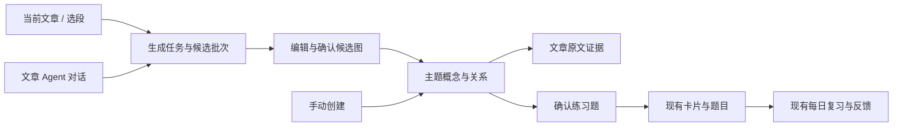

# 概念与关系：技术方案

日期：2026-10-15。版本：v2（文章学习工作区与双视图）。状态：设计提案，未实现；下述新增表、接口与文件均为计划。

关联：[需求方案](01-requirements.md) · [开发任务计划](03-development-tasks.md)

## 1. 代码现状与约束

本次通过 CodeGraph 及定点源码检查确认：

| 现状 | 依据 | 设计影响 |
| --- | --- | --- |
| 主题大纲节点是带 parentId 的树 | `apps/server/src/db/schema.ts` 的 mapNodes | 不把树节点当成多关系概念网络 |
| 现有主题图查询卡片和 cardLinks | `apps/server/src/topics/topic-graph.ts` | 原接口保留，新增独立概念图接口 |
| 卡片带 documentId、topicId、concept 文本及锚点 | `apps/server/src/db/schema.ts` 的 cards | concept 字段是卡片文本，不改名、不改语义 |
| cardLinks 类型为 same_concept/confusable/prerequisite/related | `packages/dto/src/card.ts` | 不足以承载任意领域谓词、来源及语境 |
| 题型为 cloze/compare/judge，排期按 cardId | `packages/dto/src/card.ts`、reviewStates、review.service.ts | 新知识目标关联普通练习卡，复用 SM-2 |
| reviewStates 已有 suspendedAt | `apps/server/src/db/schema.ts` | 内容变更、归档可以暂停练习 |
| Agent 经 runAgentJob，队列分发在 processors | `agent/run-agent-job.ts`、`jobs/queue.ts` | 复用执行审计、模型选择、心跳及任务重试 |
| 对话已有专用工具和写入权限判断 | `agent/conversation-tools.ts` | 新工具只请求生成候选，正式保存走明确确认接口 |
| Web 与移动端使用共享 DTO | 各 package.json 与 review service | 新字段可选、现有响应不破坏 |

使用仓库已有 React 19、@rabjs/react、Fastify、PostgreSQL/Drizzle、Zod、pi-agent-core。首版不引入图数据库、新向量集合或新的调度算法。文档中提到的库仅依据本地依赖，不要求升级。

当前工作区存在与本文功能无关的编辑器改动；未来开发必须先核对并避开并行修改。本轮仅更新三个方案文件。

## 2. 架构决策

建立独立的 `concepts` 领域模块：概念、关系、证据、候选批次及练习绑定。由主题限定语境和所有权；由文章提供证据；由卡片负责练习。

不将概念图自动写入文章脑图，也不双写旧 cardLinks 或 mapNodes。两个图保留各自语义，共处文章学习工作区，支持单独聚焦及同时对照；主题页聚合跨文章知识。概念网络为带类型和方向的一般图，允许合法多节点环；仍禁止无意义自环，不对所有关系做 DAG 校验。首版不批量迁移历史卡片，但支持显式关联和绑定已有卡片，不复制卡片。

## 3. 数据模型

所有业务读写携带服务端会话中的 userId。下表公共字段为 UUID 主键、createdAt/updatedAt；知识实体增加 userId、topicId、version（整数，初始 1）、archivedAt。主题归档后实体保留但只读，不参与新生成与入队；暂停其全部概念绑定练习。恢复主题仅解除只读，练习显式恢复。

### 3.1 正式知识

| 表 | 主要字段 | 约束与用途 |
| --- | --- | --- |
| concepts | name、normalizedName、aliases(text[])、sense、definition、example、origin(manual/agent) | definition/example 可空；sense 区分同名异义；索引 userId/topicId/normalizedName；不对名称建唯一约束 |
| concept_relations | fromConceptId、toConceptId、kind、predicate、normalizedPredicate、context、explanation、example、origin、basis(explicit/inferred/user)、identityHash | 端点同用户同主题，禁止自环；相同有效 identityHash 唯一；关系有方向 |
| concept_evidence | conceptId?、relationId?、documentId?、documentTitleSnapshot、documentHash、quote、locator(json)、basis、availability | conceptId/relationId 恰一非空；引文不可由模型伪造；文档硬删除 set null |
| concept_notes | conceptId?、relationId?、documentId?、text、version、basis、createdBy(manual/agent) | 目标恰一非空；本文说明与共享定义分开，用户明确编辑；模型补充需确认 |
| document_knowledge_refs | userId、topicId、documentId、conceptId?、relationId?、origin、removedAt | 目标恰一非空；同文章同目标有效引用唯一；文章知识成员关系独立于证据 |
| card_knowledge_links | userId、topicId、cardId、conceptId?、relationId? | 目标恰一非空；同卡同目标唯一；多对多导航，不承担复习计分 |

`kind` 首版为 composition / execution / evaluation / dependency / contrast / other；`predicate` 为面向用户的自然语言动词短语。所有边都使用显示方向，contrast 也不自动反转或双向归一。identityHash 使用 userId、topicId、源、目标、kind、规范化谓词、规范化 context 的稳定哈希。两种相反观点可以通过不同 context 保留。

关系端点使用 `(conceptId, userId, topicId)` 复合外键确保归属一致；证据、绑定和服务层进一步校验软删除及主题状态。归档时在同一事务内归档相邻有效关系、暂停相关练习；恢复不自动恢复连带对象。

证据 locator 判别联合：`{kind:'block', blockIndex, quote, prefix?, suffix?}`、`{kind:'pdf', pageNumber, quote}`、`{kind:'quote', quote}`。索引基于生成时固定正文快照。跳转先验证当前块引文，再唯一匹配上下文；有多个匹配或无匹配时只显示摘录并提示失效，不能取第一个凑数。读取已删除文档的跳转返回不可用，但不暴露其他用户资料。

本文范围通过 `document_knowledge_refs` 明确记录，不能仅从 card.documentId 或概念名称推断。文章内创建/生成确认时，同事务为所有接受的目标写入引用；支持无引文的手动引用和明确推断。关系引用可带出其端点，但返回 `membership=endpoint_context`，不自动收录端点间所有主题关系。用户移除本文关系只软删除对应引用；移除本文概念时同时移除本文涉及它的关系引用，确认影响范围，保留全部共享实体与历史证据。证据不自动复活已移除引用，重新收录需显式操作。

`concept_notes` 的 documentId 限定本文说明，独立 version；PATCH note 不改 concepts.definition 或 relation.explanation，也不递增知识语义版本。共享定义 PATCH 仍按既有失效规则处理。来源删除保留摘录；文档引用在文档硬删除时级联清理。card_knowledge_links 不要求卡片 topicId 与目标主题相同（跨篇引用可能不同），但必须同用户，目标必须属于请求 topic；不改卡片原有归属。新增引用表与导航链接提供独立的外键及权限测试。

### 3.2 候选与任务

`concept_batches`：userId、topicId、documentId(nullable on hard delete)、documentHash、selectionSnapshot?、contentSnapshot（所处理文本及块/页定位）、jobId、status、draftRevision、draft(jsonb)、coverage(jsonb)、errorCode、commitRequestHash、commitResult(jsonb)、committedAt。

状态：queued → running → ready → committed；queued/running → failed/cancelled；ready → discarded。正文变化不覆盖 ready，返回派生标记 `stale=true`，拒绝提交，需重新生成；failed/cancelled 重试创建新批次。已提交结果只读。候选成功零条也为 ready，并给 reason。批次保留至用户丢弃或删除主题，后续可另定清理策略。

`draft` 是经 Zod 校验的版本化结构，首版 schemaVersion=1：

- concepts：tempId、name、aliases、sense、definition、example、evidence[]、matchCandidates[]。
- relations：tempId、fromRef、toRef、kind、predicate、context、explanation、example、basis、evidence[]。
- reference 是 `{kind:'candidate',tempId}` 或 `{kind:'existing',conceptId,version}`；服务端验证所有 existing ID。
- proposal decision 在提交命令中指定 create / reuse / skip；reuse 默认仅追加证据和 notes，不能替换主解释。
- inferred 项必须在命令中携带 acknowledged=true。提示置信度如提供只能作为模型意见，不当事实校验。

辅助持久化：`concept_operation_requests` 保存 userId、operation、requestId、requestHash、responseJson、createdAt，唯一键为前三者，和对应业务变更同事务写入。`concept_practice_proposals` 保存 userId、目标引用及 targetVersion、exerciseKind、jobId、status(queued/running/ready/failed/cancelled)、question、answer、errorCode；题目候选不写 cards。GET `/api/concept-practice-proposals/:id` 读取题目结果，创建接口返回 `{proposalId,jobId}`，不假设现有 jobs 自带任意结果字段。

一个批次一个生成任务。沿用任务队列重试同一 job；processor 按 batchId 和状态做幂等结果写入，完成后重试不能覆盖用户已编辑的 draft。新增 jobType 与 agentType `concept_extract`，必要的题目建议使用 `concept_practice`，都接入现有审计。终态失败和取消须同步 batch 状态，不能只更新 jobs。

### 3.3 卡片导航关联与主要练习绑定

`concept_practice_bindings`：id、userId、topicId、conceptId?、relationId?、cardId(unique)、exerciseKind(recall/compare/scenario)、targetVersion、needsRefresh、createdAt。目标恰一非空；同一有效目标同一 exerciseKind 唯一。首版每种题型一个默认练习，重试返回已有项。

`card_knowledge_links` 允许同卡多个导航目标；`concept_practice_bindings.cardId` 唯一使同卡至多一个主要练习目标。关联关系卡时可以通过端点解析其涉及概念，无需复制导航行。主要目标的绑定同时保证对应导航链接存在；删除主要目标链接须先解除练习绑定。单纯导航关联不使该目标继承反馈，不因次要关联变化暂停整张卡。

新增 `bindExistingConceptPractice(userId, input)`：校验现有 cardId 的所有权、未删除/未拒绝状态和所选题型/题目可兼容，展示当前题面答案让用户确认后绑定。不改 card_questions、review_states 或 review_logs。已有主绑定不同则409；目标同题型已有另一张卡则返回冲突供用户选择，不悄悄替换。不在队列的卡仅绑定不入队，另走显式加入流程；暂停卡保留暂停状态。未绑定卡可只建立导航链接。

新建的一条绑定对应一张普通 Card 和一条 CardQuestion。已有卡保留已有题目结构，不为绑定而删除其他题目。映射 recall→cloze、compare→compare、scenario→judge；判定题必须包含命题和解释，回忆题遵守现有挖空格式，所有生成题须在预览中可修改。Card.concept 保存可读的知识陈述，Card.example 保存答案/例子，关联 question 为正式题面与答案。documentId 优先使用有效主出处，没有则为空；新卡默认 mapNodeId 与 outlineParentId 留空；用户可通过既有脑图挂载操作将同一 cardId 放入当前文章的合法位置，不复制卡片、不自动重排。已有卡片保留原有文章和脑图归属，不能为适应新视图改写。

默认练习在独立服务事务中创建 cards、card_questions、review_states 和 binding；须核对现有卡片创建服务的副作用，采用同事务写入能力，不能先创建卡片再补绑定。只保存概念不调用卡片创建。新 review DTO 可追加可选 `knowledgeTarget` 摘要，旧客户端忽略也能看普通文本题。

内容修订递增 version，并暂停绑定练习、标记 needsRefresh；概念的 name/sense/definition 变化也会使相邻关系 version 递增并暂停其练习。只追加出处或 notes 不改变已确认语义，不触发重置。显式 refresh 保存用户确认的新题面与答案，更新 targetVersion、清除 needsRefresh，重置 SM-2 初始学习状态；review_logs 保留。暂停后拒绝陈旧界面的反馈。状态展示直接来自相关练习反馈及到期时间，不计算未经验证的知识掌握分。

## 4. 核心接口与事务

新增 REST 命名空间；所有 UUID、字符串长度、数量和所有权均服务端校验。名称上限 200 字符、别名最多 10 个每个 200、sense/context 上限 500、definition/explanation/example 上限 4000、predicate 上限 100、quote 上限 2000；按 Unicode code points 计数，与仓库已有约定一致。

| 方法与路径 | 输入 / 结果 |
| --- | --- |
| GET `/api/topics/:id/concepts` | q、cursor、limit(默认50，最大100)；返回分页概念 |
| GET `/api/topics/:id/concept-graph` | focusId?、documentId?、cursor?；每页最多50节点，边只含本页已返回端点，带可继续展开信息 |
| GET `/api/concepts/:id` | 概念、分页相邻关系、证据、练习摘要 |
| POST `/api/topics/:id/concepts` | name、aliases、sense、definition、example、evidence；返回概念 |
| PATCH `/api/concepts/:id` | expectedVersion + 可编辑字段；冲突409 |
| POST `/api/concepts/:id/archive`、`/restore` | expectedVersion；返回影响数量，不自动恢复关系/练习 |
| GET `/api/concept-relations/:id` | 关系、端点摘要、证据、练习摘要 |
| POST `/api/topics/:id/concept-relations` | 两端ID、kind、predicate、context、explanation、example、basis、evidence；重复返回已有关系及补充结果 |
| PATCH `/api/concept-relations/:id` | expectedVersion + 可编辑字段；语义变化暂停练习 |
| POST `/api/concept-relations/:id/archive`、`/restore` | 校验两个端点均有效 |
| POST `/api/documents/:id/concept-batches` | topicId、scope(document/selection)、selection?、expectedDocumentHash、requestId；202 `{batchId,jobId}` |
| GET `/api/concept-batches/:id` | 状态、覆盖范围、draftRevision、候选、stale、错误或提交结果 |
| PATCH `/api/concept-batches/:id` | expectedDraftRevision + draft；只允许 ready 且未过期 |
| POST `/api/concept-batches/:id/commit` | expectedDraftRevision、conceptDecisions、relationDecisions、requestId；返回 ID 映射、创建/补充计数 |
| POST `/api/concept-batches/:id/discard` | ready→discarded；不删除正式内容 |
| POST `/api/concept-practice-proposals` | targetKind、targetId、exerciseKind；202 `{proposalId,jobId}`；返回 proposalId/jobId，通过建议详情接口取题目，无卡片写入 |
| POST `/api/concept-practices` | targetKind、targetId、expectedVersion、exerciseKind、question、answer、requestId；创建或返回 binding/card |
| POST `/api/concept-practices/:id/refresh` | expectedVersion、question、answer；更新并重置该练习 |

生成任务的取消复用现有 job 取消入口，后端将批次标为 cancelled；重试通过创建批次接口产生新 batch，并可带 retryOfBatchId 用于追踪。requestId 对用户和操作范围唯一，重复请求且 body 一致返回原响应，body 不同返回409；使用数据库幂等记录，不只依赖前端禁用按钮。

手动「保存概念与多条关系」复用一个 `saveConceptBundle(userId, topicId, input)` 事务及 POST `/api/topics/:id/concept-bundles`，输入 concept(create/reuse)、relations、requestId；原子创建另一端新节点及关系。单实体接口适用于已有条目独立编辑。

确认事务：锁定批次与 topic 行 → 核对 ownership、状态、draftRevision、原文 hash、existing version → 解析临时 ID 与选取依赖 → 创建概念/补充 notes 与 evidence → 去重关系/追加 evidence → 写 commitResult → 状态改 committed。任一步失败全量回滚。名称匹配使用 NFKC、去首尾空白、连续空白折叠和小写转换，仅作候选检索；不移除标点或改变存储名称。context/predicate 哈希规范化使用同一规则。证据以目标 ID、documentId、documentHash、规范化 locator、quote 的哈希去重。

同主题 commit/create bundle 使用 topic 行锁串行化身份判定，关系另有唯一索引兜底。已 committed 同命令返回原结果，不同命令409。

端点所依赖候选被 skip 时返回422并指出关系；不悄悄恢复已取消节点。内容版本冲突409要求刷新预览，不自动覆盖。未授权和不存在对象统一404。语义内容不由日志原样输出，记录 ID、计数、耗时和错误类型即可。

### 4.1 文章范围、联动和已有卡接口

| 方法与路径 | 契约 |
| --- | --- |
| GET `/api/documents/:id/knowledge?topicId=...` | 分页返回本文引用概念、本文关系、端点上下文、本文 notes 和证据；scope 扩展其他文章须显式请求，返回来源标记 |
| POST `/api/documents/:id/knowledge-refs` | topicId、targetKind、targetId、requestId；幂等引用已有目标，不复制实体 |
| DELETE `/api/documents/:id/knowledge-refs/:refId` | 只解除本文引用；概念引用移除需要 confirmDependentRelations 明确确认连带本文关系 |
| POST `/api/concept-notes`、PATCH `/api/concept-notes/:id` | 目标、documentId、text；更新携带 expectedVersion，限定本文编辑范围 |
| GET/POST `/api/cards/:id/knowledge-links` | 读取或建立导航目标；POST 验证目标归属 |
| DELETE `/api/cards/:id/knowledge-links/:linkId` | 解除导航链接；存在主要练习绑定时409提示先解除 |
| POST `/api/concept-practices/bind-existing` | cardId、targetKind、targetId、expectedVersion、exerciseKind；确认后绑定，不改排期 |
| DELETE `/api/concept-practices/:id` | 解除主要练习目标，保留卡片、现有排期、历史及导航关联 |
| GET `/api/documents/:id/knowledge-locations?topicId=...&targetKind=...&targetId=...` | 返回当前文章匹配 cardId/annotationId/画布节点引用及来源状态，多处分别列出 |

解析联动位置时只接受已有真实脑图挂载与可验证原文锚点；没有脑图节点时返回 evidence-only，客户端展示摘录/定位原文而非伪造节点。目标与文章均独立鉴权。人工 bundle、批次 commit 与 refs 写入使用同一事务；主题入口无 documentId 时不创建文章引用。本文视图可读全部已授权主题范围，但一次编辑、生成与联动固定一个显式 topicId。

## 5. Agent 管线

1. **获取快照**：校验已保存且用户可读的当前文档，按既有文档文本/块抽取能力生成稳定正文 hash；排除标题修改等非正文变更。不以 updatedAt 单独判断正文版本。
2. **拆分范围**：按正文块打包，每块保留定位；一个模型分片目标不超过 8,000 字符，超长块按字符边界拆分并记录偏移。总计最多60,000；记录全部 coverage，不能只处理首段后标完成。
3. **抽取**：以文章数据为引用材料，提示模型产出带 tempId、引文和块/页位置的 JSON；模型不具备正式知识写入工具，文章中的指令不提升为工具权限。
4. **整合**：合并同一批次内明显相同候选；按同主题名称/别名检索最多5个候选匹配，不自动合并同名异义。保留语境差异。
5. **验证**：结构、限制、端点闭合、谓词方向、自环、引用是否真实位于快照、现有 ID 所有权。引用存在只证明出处真实，不证明推断语义正确；后者靠标记和人工确认。
6. **落候选**：校验有效结果后写 ready。结构无效允许一次格式修复，仍失败则结构化错误；不保存部分正式节点。超出硬限时要求重新缩小范围，不能偷偷删边。
7. **确认**：由 UI 或明确确认批次的命令调用事务，生成 Agent 无直接 commit 工具。对话工具 `propose_article_concepts` 返回 batchId/jobId，动作卡可再次打开预览。

使用现有模型配置及队列生命周期、取消和心跳。concept_extract 失败不得通过通用文档流水线把已成功读取的文章标为 failed；将其排除于 pipelineDocumentId 的失败传播路径，并覆盖测试。取消/过期 worker 返回结果时通过 batch 状态条件写入，防止覆盖 cancelled。

## 6. 前端工作区、联动和状态恢复

### 6.1 组件边界与布局

新增 `features/concepts/` 承载领域 Service、图、索引、详情、编辑及候选；新增 `features/study-workspace/` 承载工作区容器、布局、视图状态和联动协调。遵守既有 @rabjs/react Service/视图模式，不另造阅读器或脑图存储。

`StudyWorkspace` 挂在现有 DocsPage 工作区；正文与现有脑图组件通过 adapter 接入，主题托管 DocsPage 使用同一组件。脑图、正式概念图、候选图各有独立 viewKey，不因切候选而覆盖正式图视口。候选默认显示在概念区域，详情和表单在所属区域内部展开。对话结果动作引用 batchId，可恢复到同一候选。

布局 `mode=outline|concepts|compare`，`arrangement=stacked|columns`。按工作区可用宽高而不是屏幕型号决定：正文最小360px、每个图区域最小320px宽及260px高；三栏空间不够时 compare 用右侧上下结构，上下结构也不足时按最近主动焦点降级单视图。以上是原型起点，不是已验证的可用性结论。preferredMode/arrangement 与 effectiveMode 分离，尺寸恢复后还原偏好；区域 resize 限制比例在实际最小尺寸范围，不隐藏溢出内容。窄屏正文与当前学习区可上下排列。分隔线支持键盘调整。

用户主动请求生成可切到 concepts（compare 则保留）；任务完成只能提示，不切模式、不自动 fit。主题页复用概念组件，拥有独立主题视口状态。

### 6.2 独立状态协议

新增 `StudyWorkspaceStateV1`（前端本地类型，不写知识业务表）：

- key：userId + documentId + topicScopeId；正文锚点按 userId+documentId 单独复用；主题概念图按 userId+topicId 独立存储。
- layout：preferredMode、arrangement、splitRatios、临时放大前布局；effectiveMode 仅派生不覆盖偏好。
- outline：viewport(x,y,zoom)、expandedIds、selectedId、anchorNodeId、anchorScreenOffset。
- concepts：viewport、selectedTarget、focusId、filters、graphOrList、listScroll、anchorNodeId、anchorScreenOffset。
- document：block/quote/page anchor、intraBlockOffset、fallbackScroll；详情：目标和scroll。
- draft：batchId、draftRevision、decisionState；本地未保存表单通过独立 draft key 存储，不混进视口 JSON。

协议：`capture(viewKey): ViewSnapshot`、`restore(viewKey, snapshot, viewportSize): RestoreResult`；脑图 adapter 读写现有缩放/展开状态，不建立第二套真值。显式定位前保存内存 history frame，返回恢复该 frame。

内存 store 保证切换/临时卸载即时恢复；本机 localStorage 保存带 schemaVersion 的布局和视口（500ms debounce，切路由/visibilitychange 同步 flush，最多最近50篇 LRU）；内容编辑与未确认勾选保存 sessionStorage，当前标签刷新可恢复，退出登录清理该用户草稿。已保存候选回服务端恢复，local revision 不匹配时提供差异处理而非直接覆盖。页面卸载只依赖最后一次自动保存，不依赖异步 unload 请求。存储不可用时退回内存并提示刷新无法恢复未保存编辑。

本地 key 严格按用户隔离；其他标签的 storage/sync 事件不立即应用视口，仅同步业务数据并标记表单版本冲突。返回路径/主题托管上下文沿用当前路由，不从持久化视图状态恢复导航来源。

恢复顺序：加载业务数据 → 容器 ResizeObserver 得到有效尺寸 → 应用折叠/过滤 → 布局节点 → 恢复焦点及屏幕相对位置/缩放 → 恢复滚动。正文先匹配原段落/页码，再使用安全范围内 fallback；丢失节点保留可用相机与最近有效邻域，提示目标变化，不跳到别的文章。只有首次无可用状态或显式“适应全部”执行 fit-all。增量数据尽量沿用已有节点位置；需要重排时保持焦点屏幕位置不变。隐藏视图不因零尺寸测量清空状态。

### 6.3 联动协议与图渲染

选择事件 `{eventId, originView, documentId, topicId, target, intent:'highlight'|'locate'}`。`StudyLinkService` 根据 card_knowledge_links、主要练习绑定和 evidence/location 映射计算对方高亮集合；只处理当前文章/主题并去重 eventId，防止双方选择回调循环。

highlight 不写对方 selectedId、viewport、expandedIds 或 filters；隐藏/未加载目标显示计数。locate 为用户显式动作，多个位置先选择；然后分页加载、临时清除阻挡过滤/展开路径、平移并保留合理缩放，保存之前快照供返回。联动不同时改变两图相机。证据失效只显示说明与摘录。

概念图首版 React+SVG，按一般有向图布局，不能复用脑图的单父层级布局；循环边正确绘制。最多50节点局部展示，支持分页和邻居展开，索引可访问全部数据。`layoutConceptGraph(nodes, edges, previousPositions?)` 尽量稳定旧位置；关系标签可点、键盘可达。关系图/索引各自保留状态。局部关系浮层是后续可选 renderer，不改变知识结构。

### 6.4 加载与同步

任务轮询复用现有能力，终态停止；按 document/topic/viewKey 使用请求代次取消旧响应。新表含 document refs、notes、card links 的业务变化接入现有 sync；更新实体缓存和高亮映射，但不重置用户相机/过滤/草稿。表单遇版本变更提示冲突，不自动丢弃输入。

正文跳转继续使用 topicDocPath、anchor/annotation 与证据解析接口；出发前 capture，返回恢复。只存在 quote 时展示摘录，不伪造 annotationId。新卡可调用既有脑图挂载流程选择位置；移动/移除画布引用只改展示，不删除知识绑定或卡片，卡片真正删除时解除导航链接并遵循现有复习删除逻辑。

## 7. 兼容、发布与验证

迁移仅增表、增可选 DTO 字段和 job/agent 枚举检查约束，不改旧 cards.concept，不回填推断知识，不复写旧复习历史。迁移编号由生成器按开发时最新顺序确定。新增表随用户/主题硬删除清理，来源文档删除只断开来源；删除绑定不删除 review_logs。

特性开关 `CONCEPTS_ENABLED` 默认 false，关闭时隐藏新入口并拒绝新写入/入队；不破坏已存在普通练习卡的复习。发布顺序：迁移 → 支持新任务类型的 server/worker → Web → 小范围开关。滚动部署时所有 worker 支持新类型后才开放生成。回退优先关闭入口和新任务生产，保留数据及具备新枚举兼容的服务，避免回退到无法识别历史任务的旧 worker。

验证覆盖：纯逻辑（规范化、去重、引用、图布局）、真实 Postgres 事务/权限/幂等、队列失败取消、Agent 固定夹具、前端异步竞态、真实浏览器完整链路、旧客户端文本复习。模型人工样本评审与确定性自动测试分开；不能以一次模型输出成功代替验证。

## 8. 主要取舍

独立知识表比给卡片加字段多一些工作，但能稳定支持多篇来源和独立关系；卡片作为练习载体则保住原复习闭环。候选先确认增加一步，却让自动生成与长期知识之间有清晰边界。首版主题内限定语义，避免一开始承担跨领域消歧与大规模本体治理。

本轮架构取舍：优先统一对象身份和引用、独立保存视图状态，再实现双视图对照。局部关系浮层可复用联动映射，完整混合图不进入首版。这样布局试验失败时无需迁移知识数据；额外维护成本集中在工作区状态和选择协调，避免混合图布局与编辑规则相互牵制。
